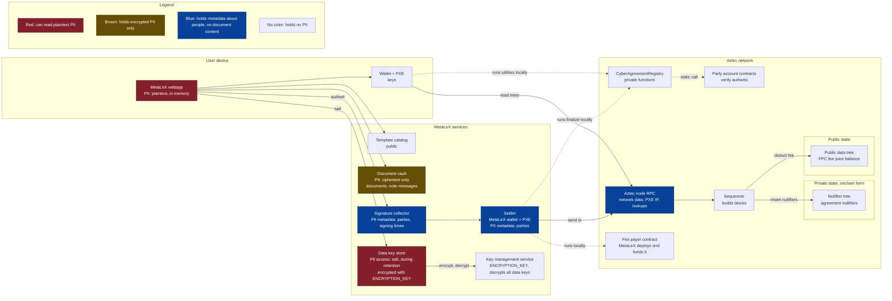
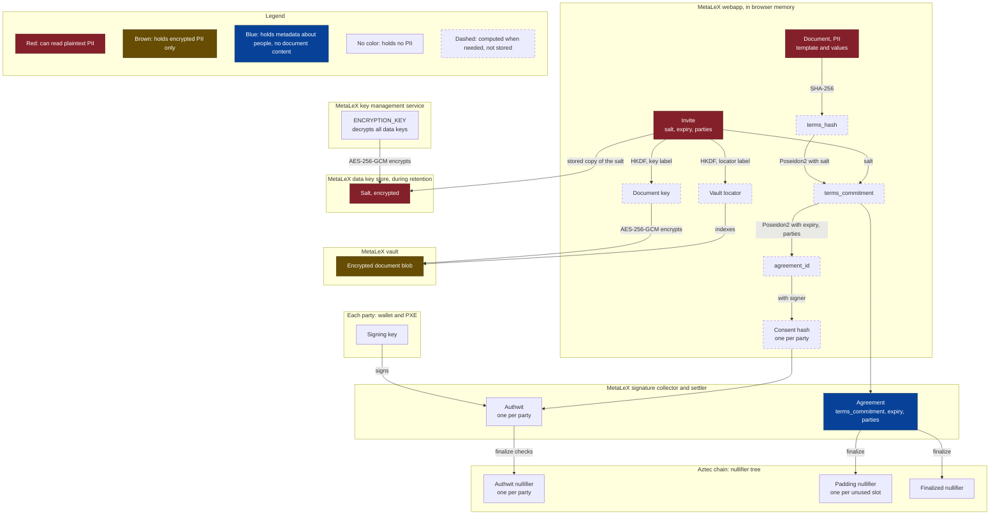

# Private Agreement Registry on Aztec: Architecture

This document describes the proof of concept (PoC) port of `src/CyberAgreementRegistry.sol` to Aztec.
The PoC supports the happy path of one agreement: every party signs offchain, and MetaLeX settles all signatures
in one private transaction (`finalize`). See [USER-FLOWS.md](USER-FLOWS.md) for the step-by-step flows.
[EVM retrofit: hashes onchain](#evm-retrofit-hashes-onchain) applies the same offchain design to the EVM registry.

Toolchain: Aztec 6.0.0, aztec-nr v6.0.0, Noir 1.0.0-rc.3.

## Design rules

1. The chain keeps only nullifiers. Agreement text, field values and party addresses stay offchain. When a later
   contract keeps private notes, a note holds a reference (for example a salt), not PII. The PII stays in the
   document vault. The note messages also go to the vault, not onchain.
2. Each party signs offchain with a private authwit. MetaLeX collects the authwits and sends one `finalize` tx
   when all parties signed. No party needs to send a tx or hold a fee token.
3. The parties, and the people they share an invite with, know the salt. MetaLeX keeps the salt in its data key
   store for a fixed retention period to make the webapp easier to use. During that period, MetaLeX can read the
   agreement. Users accept this trust. The collector and the settler never get the salt, the terms or the document
   text.
4. The MetaLeX services hold no user account keys. The data key store holds data keys (salts) only.

## Components



The legend explains the colors. See [PII: who can see what](#pii-who-can-see-what) for the details.

| Component                         | Who runs it                                       | What it stores                                                            | What it can read                                                  |
|-----------------------------------|---------------------------------------------------|---------------------------------------------------------------------------|-------------------------------------------------------------------|
| `CyberAgreementRegistry` contract | Aztec network                                     | Nullifiers only (private state)                                           | Nothing after the tx                                              |
| User wallet and PXE               | User (browser embedded wallet or an Aztec wallet) | Account keys                                                              | What the user opens in it                                         |
| MetaLeX webapp                    | MetaLeX (code), user (runtime)                    | The invites that the user keeps                                           | What the user opens in it                                         |
| Template catalog                  | MetaLeX                                           | Public legal templates. The webapp copies the full text into each document | Public data only                                                  |
| Document vault                    | MetaLeX                                           | AES-256-GCM document blobs, keyed by a locator; encrypted note messages for each recipient | Locator, blob size, upload and fetch times                        |
| Signature collector               | MetaLeX                                           | Onboarded account data, `Agreement` structs without salt, authwits        | Parties, expiry, agreement id, who signed and when                |
| Settler                           | MetaLeX                                           | Its own account keys, the public signing keys of the party accounts       | The same as the collector, and the finalize status                |
| Data key store                    | MetaLeX                                           | Data keys (salts) encrypted with `ENCRYPTION_KEY`, until the end of the retention period | With the vault and the collector: all data of each stored agreement |
| Key management service (KMS)      | MetaLeX account at a cloud KMS                    | `ENCRYPTION_KEY`; the key never leaves the KMS                            | Nothing; it logs each decrypt                                     |
| Party account contracts           | Aztec network; each user owns one                 | The signing public key, in the contract instance (`immutables_hash`)      | Nothing after the tx                                              |
| Fee payer contract (FPC)          | Aztec network; MetaLeX deploys and funds it       | Fee juice balance (public state)                                          | That a sponsored tx happened                                      |
| Aztec node RPC                    | Aztec network                                     | Chain state                                                               | Queries from each PXE (nullifier lookups, tx hashes)              |
| Sequencer                         | Aztec network                                     | Nothing; it writes tx effects into the trees                              | Tx effects: nullifiers, fee payer, fee                            |

## Data model

### Agreement (circuit input)

```noir
struct Agreement {
    terms_commitment: Field,              // hides the terms; only salt holders can open it
    expiry: u64,                          // 0 means no expiry
    party_count: u32,
    parties: [AztecAddress; MAX_PARTIES], // unused slots are zero
}
```

`MAX_PARTIES` is 4. Each party adds one private call to its account contract in the finalize tx.

The struct holds no salt and no `terms_hash`. So the settler can run `finalize` and still cannot open the document.

### Derived values

| Value               | Formula                                                                                   | Where it is computed                       |
|---------------------|-------------------------------------------------------------------------------------------|--------------------------------------------|
| `terms_hash`        | `sha256(canonical JSON of the document)` reduced into the field                           | Webapp                                     |
| `terms_commitment`  | `poseidon2([terms_hash, salt], "metalex.agreement.terms.v1")`                             | Webapp, with the `terms_commitment_of` utility |
| `agreement_id`      | `poseidon2([terms_commitment, expiry, party_count, parties...], "metalex.agreement.id.v1")` | Circuit, and the `agreement_id` utility    |
| Consent hash        | `compute_inner_authwit_hash(["metalex.agreement.consent.v1", agreement_id, signer])`      | Circuit, and the `consent_hash_of` utility |
| Authwit             | The signature of the party over `poseidon2([registry, chain_id, version, consent hash])`  | Party wallet                               |
| Authwit nullifier   | `compute_authwit_nullifier(signer, consent hash)`, one per party                          | Circuit                                    |
| Padding nullifier   | `poseidon2([agreement_id, slot], "metalex.agreement.padding.v1")`, one per unused slot     | Circuit                                    |
| Finalized nullifier | `poseidon2([agreement_id], "metalex.agreement.finalized.v1")`                             | Circuit, and the `is_finalized` utility    |
| Vault locator       | `HKDF-SHA256(ikm = salt, salt = empty, info = "metalex.doc.locator.v1", 32 bytes)`        | Webapp                                     |
| Document key        | `HKDF-SHA256(ikm = salt, salt = empty, info = "metalex.doc.key.v1", 32 bytes)`            | Webapp                                     |

The consent hash holds the signer. Two parties that sign the same agreement must sign different messages. The PXE
finds an authwit by its message hash, and that hash does not hold the signer.

The PoC uses one hash for the whole document. A Poseidon Merkle root over the fields would let a party later prove
one field in a circuit without the others.

The salt is the root secret of an agreement. A holder of the salt can open the terms commitment, find the vault
blob and decrypt it. Without the salt, nobody can link the agreement id to a document. The webapp must make the
salt with a secure random source.

### Invite

The invite is what a party shares with a counterparty or an auditor. It holds the salt, the expiry and the party
addresses. With the invite and the vault blob, the webapp can rebuild the `Agreement` struct and the agreement id.

The webapp puts the invite in the URL fragment (after `#`). A browser does not send the fragment to the server, so
a shared link does not give the invite to MetaLeX. A holder of the invite can read the whole document.

The webapp also gives the salt to the MetaLeX data key store. The store gives it back to a signed-in party, so the
party can open the agreement on any device without the link. The webapp gets the expiry and the parties from the
collector. The store deletes the salt at the end of the retention period. The vault keeps the encrypted document.
After that, a party opens the document with its own copy of the invite, or with a copy from another party. The PoC
has an in-memory data key store in `scripts/poc.ts`.

The webapp treats each party address in an invite as untrusted and checks that it is a valid address.

### Canonical JSON

All parties must get the same `terms_hash` from the same document. So the webapp writes the document as one fixed
JSON string before it hashes it:

- It sorts the keys of each object.
- It writes no spaces and no line breaks.
- It keeps the order of each array.
- It writes strings and numbers as `JSON.stringify` does.

The standard for this is RFC 8785, the JSON Canonicalization Scheme (JCS). The PoC function `canonicalJson` in
`scripts/poc.ts` gives the JCS output for strings, numbers, arrays and objects. A webapp in another language must use
JCS. The same string is the plaintext of the vault blob, so a party decrypts the exact bytes that were hashed.

The document holds:

- `template`: the title, the full legal text and the field names, copied from the public catalog. So the vault
  blob is the whole agreement, and `terms_hash` commits to the exact text.
- `globalValues`: the values of the fields that apply to the whole agreement.
- `partyValues`: for each party address, the values of that party. These hold the PII.

The salt is not in the document. It is in the invite. The expiry is a field of `Agreement`. The value arrays are an
open item (see [Limits and open items](#limits-and-open-items)).

Example document:

```json
{
  "template": {
    "title": "Mutual Non-Disclosure Agreement",
    "globalFields": ["effectiveDate"],
    "partyFields": ["name"],
    "text": [
      "Purpose. The parties want to discuss a possible business relationship (the \"Purpose\"). ...",
      "..."
    ]
  },
  "globalValues": ["2026-11-01"],
  "partyValues": [
    ["<Alice address>", ["Alice Corp"]],
    ["<Bob address>", ["Bob LLC"]]
  ]
}
```

Its canonical JSON, which the webapp hashes:

```text
{"globalValues":["2026-11-01"],"partyValues":[["<Alice address>",["Alice Corp"]],["<Bob address>",["Bob LLC"]]],"template":{"globalFields":["effectiveDate"],"partyFields":["name"],"text":["Purpose. ...","..."],"title":"Mutual Non-Disclosure Agreement"}}
```

### Secrets, keys and hashes

Each box is a place where a value lives. The legend explains the colors and the dashed boxes.



| Value                   | Kind           | Made by                               | Known to                                           | Stored at                                                     |
|-------------------------|----------------|---------------------------------------|----------------------------------------------------|---------------------------------------------------------------|
| Signing key             | Secret         | Party's wallet                        | That party                                         | Wallet                                                        |
| Salt                    | Secret         | Creator's webapp, random              | All parties, each holder of the invite, and MetaLeX during retention | Inside the invite; encrypted in the MetaLeX data key store during retention; never onchain |
| `ENCRYPTION_KEY`        | Secret         | MetaLeX KMS                           | Nobody; only the KMS uses it                       | MetaLeX KMS; it decrypts all data keys in the store           |
| Document                | PII            | Creator's webapp                      | All parties, and each holder of the invite         | Plaintext only in webapp memory; ciphertext in the vault      |
| `terms_hash`            | Hash           | Webapp, SHA-256 of the document       | Each holder of the invite                          | Not stored                                                    |
| `terms_commitment`      | Hash           | Webapp, Poseidon2                     | Each holder of the invite, and MetaLeX             | In the collector                                              |
| `agreement_id`          | Hash           | Webapp and circuit, Poseidon2         | Each holder of the invite, and MetaLeX             | Collector index                                               |
| Consent hash            | Hash           | Webapp and circuit                    | The same as `agreement_id`                         | Not stored                                                    |
| Authwit                 | Signature      | Party's wallet                        | That party and MetaLeX                             | Collector, until the finalize tx                              |
| Authwit nullifier       | Hash           | Circuit                               | Public                                             | Nullifier tree                                                |
| Padding nullifier       | Hash           | Circuit                               | Public                                             | Nullifier tree                                                |
| Finalized nullifier     | Hash           | Circuit                               | Public                                             | Nullifier tree                                                |
| Vault locator           | Derived id     | Webapp, HKDF of the salt              | Each holder of the invite, and the MetaLeX vault   | Vault index                                                   |
| Document key            | Derived secret | Webapp, HKDF of the salt              | Each holder of the invite                          | Not stored                                                    |
| Encrypted document blob | Ciphertext     | Creator's webapp, AES-256-GCM         | MetaLeX stores it; only salt holders decrypt it, MetaLeX among them during retention | MetaLeX vault                    |

The signing key of each party protects the account. The salt protects one agreement. Without the salt, a chain
observer cannot link the three kinds of nullifiers to each other or to an agreement.

### What goes onchain

The finalize tx was measured on a local network (see [README.md](README.md#verification)):

| Tx field                                    | Value for `finalize`                                                                   |
|---------------------------------------------|----------------------------------------------------------------------------------------|
| Nullifiers                                  | 6: the tx nullifier, one per party slot (authwit or padding), the finalized nullifier |
| Note hashes                                 | 0                                                                                      |
| Private logs                                | 0                                                                                      |
| Public logs                                 | 0                                                                                      |
| Fee payer                                   | The FPC address                                                                        |
| Expiration timestamp                        | `min(expiry, anchor + 1 day)`                                                          |
| Anchor block header, gas settings, gas used | Same for all calls to this function                                                    |

The number of nullifiers does not change with the number of parties. Each unused slot adds a padding nullifier. The
local network run measured 6 nullifiers for one party and for two parties.

## Mapping from the Solidity registry

Each row compares one concept. "Today" is `src/CyberAgreementRegistry.sol`. "Proposed" is this PoC.

| Concept                 | Today                                                                                   | Proposed                                                                                                                         |
|-------------------------|-----------------------------------------------------------------------------------------|----------------------------------------------------------------------------------------------------------------------------------|
| Template                | Today, stored onchain in `templates` (title, URI, field name arrays).                   | Proposed, an entry in the public MetaLeX catalog. The document includes its full text, and `terms_hash` commits to it.           |
| Global and party values | Today, `string[]` arrays stored onchain.                                                | Proposed, fields in the encrypted document in the vault.                                                                         |
| Parties                 | Today, `address[]` stored onchain, plus `agreementsForParty`.                           | Proposed, a fixed array in the circuit input, the invite and the collector. Nothing onchain.                                     |
| Agreement id            | Today, `keccak256` over creator, template, values, parties, expiry.                     | Proposed, Poseidon2 over `terms_commitment`, expiry and parties. No creator role.                                                |
| Create                  | Today, `createBoundContract` or `createBoundContractAndSignFor` stores the agreement.   | Proposed, nothing onchain. The creator puts the document in the vault and shares the invite.                                     |
| Signature               | Today, an EIP-712 ECDSA signature for each party, checked onchain by `signContract`.    | Proposed, a private authwit for each party, made offchain. `finalize` checks each authwit, and an authwit nullifier records it.  |
| Relayer                 | Today, any relayer submits a signature with `...For`. `delegations` lets a delegate sign. | Proposed, any account can send `finalize` with the authwits. The MetaLeX settler does this.                                     |
| Finalize                | Today, the last signature sets `finalized`, or the finalizer calls `finalizeContract`.  | Proposed, one `finalize` tx after all parties signed. The finalized nullifier records it.                                        |
| Signing time            | Today, `signedAt` stores the time of each signature.                                    | Proposed, the block of the finalize tx gives the time for all parties. Only the collector knows when each party signed.         |
| Duplicate finalize      | Today, `ContractAlreadyFinalized` checks storage.                                       | Proposed, a second finalize gives the same finalized nullifier, so the network rejects the tx.                                   |
| Expiry                  | Today, `block.timestamp` checks.                                                        | Proposed, `set_expiration_timestamp(expiry)`. The network drops the finalize tx after the expiry.                                |
| Status                  | Today, `isFinalized` and `hasSigned` read storage.                                      | Proposed, the `is_finalized` utility asks the node for the finalized nullifier.                                                  |
| Events                  | Today, public `ContractCreated`, `AgreementSigned` and `ContractFinalized` logs.        | Proposed, no events. A holder of the invite reads the status from the chain.                                                     |
| Gas                     | Today, the signer or a relayer pays ETH.                                                | Proposed, the MetaLeX FPC pays the fee of the finalize tx.                                                                       |

Not in this PoC: void, open party slots, secret hash, finalizer, signer conditions, escrow signatures.

## MetaLeX privacy data layer

Only the data key store gets the salt, and only for the retention period. The other MetaLeX services never get the
salt, the terms or the document text.

### Signature collector

- At onboarding, the webapp gives the collector the address, the account instance and the signing public key of
  the user. These are public data. The settler needs them to run the authwit check of the account.
- The creator's webapp gives the collector the `Agreement` struct. The struct holds no salt.
- Each party's webapp gives the collector one authwit. The collector shows which parties signed.
- When all parties signed, the collector gives the struct and the authwits to the settler.

### Settler

- The settler is a MetaLeX account in its own wallet and PXE.
- For each party, the settler registers the account instance and stores the signing public key. The account
  contract checks that key against its `immutables_hash`. No secret of the party is needed.
- The settler sends `finalize` with the authwits, and adds the party addresses as PXE scopes. A scope lets the PXE
  read the key that it stored for that address. It gives no access to party keys.
- The authwit check of the account must read no private state of the owner. The initializerless Schnorr account
  meets this. An account that keeps its signing key in a private note does not, because only the owner can read
  that note.

### Document vault

- The webapp encrypts the document with the document key and uploads it at the vault locator.
- The vault cannot compute the agreement id, because it does not have the salt.
- The vault is also the backup of the legal text. A party needs the text to know what it signed.
- The vault also delivers private notes. A contract that makes a note sends its message offchain
  (`MessageDelivery::offchain` in aztec-nr), not as an onchain log. The PXE that sends the tx gives each message to
  the vault. The vault keeps it for its recipient: the note owner, and each other recipient that the contract names
  with `NoteMessage::deliver_to`. A recipient can prove that the note exists, but only the owner can use it.
- Each note message is encrypted to the public key of its recipient. The vault holds ciphertext only.
- The vault must keep each note message available until the retention period ends. If the vault loses a message,
  the recipient loses the content of that note. The onchain note hash stays, but nothing can open it.
- Note messages do not go onchain, so deletion at the end of the retention period removes them.

### Data key store

- The store keeps data keys. A data key opens the data of one unit of access. Today the only unit is an agreement,
  and its data key is the salt. Later units can be a cyberCorp or a group in a cyberCorp.
- An access rule (ACL) controls each data key. For an agreement, the rule lets each signed-in party of that
  agreement get the salt.
- With a stored salt and the vault blob, MetaLeX can read the whole agreement. Users accept this trust for the
  retention period.
- Each kind of unit has a retention period. The store deletes an agreement salt at the end of its period. After
  that, MetaLeX cannot read the agreement.
- The end of the period deletes only the data key. The vault keeps the encrypted document. Each holder of the
  invite can still fetch and decrypt it.
- The store encrypts each data key with `ENCRYPTION_KEY`, with AES-256-GCM and a random IV, before it writes the
  row. `ENCRYPTION_KEY` decrypts all data keys. It is in a key management service (KMS), not in the database or the
  server environment. Only the store server role can ask the KMS to decrypt. The KMS logs each decrypt.
- The database also encrypts its storage, but that protects only against a stolen disk or backup. The database
  gives plaintext rows to each connection with valid credentials. The store encryption makes a database copy give
  only ciphertext.
- The store encryption does not stop MetaLeX. The store server can decrypt, because it must give the salt back to
  the user.

### Fee payer contract

- The FPC is an onchain contract on Aztec. MetaLeX deploys it and funds it with fee juice. Its balance is public
  state.
- The FPC pays the fee of the finalize tx, so no user needs a fee token. The tx shows the FPC as fee payer.
- The local network test uses the canonical SponsoredFPC. A mainnet FPC must limit its use, for example to the
  settler account. This PoC does not include that FPC.

### Node RPC

Each PXE asks a node for nullifier status, tx effects and block data. The node sees these queries. MetaLeX can run a
node for its users. A user who wants more privacy can use a separate node.

## EVM retrofit: hashes onchain

The EVM system stays in use. This section applies the privacy design of this PoC to the EVM
`CyberAgreementRegistry`. The EVM chain keeps salted hashes of the values, not the values. This is a design only.
No code exists for it.

### Design

1. The webapp makes the document and a random salt, as in the Aztec design. It encrypts the document into the
   vault. It gives the invite to the parties and the salt to the data key store.
2. The global values become one EIP-712 struct, `Terms { string[] values; bytes32 salt; }`. The values of each
   party become one `PartyTerms { address party; string[] values; bytes32 salt; }`.
3. The registry stores `hashStruct(Terms)` and one `hashStruct(PartyTerms)` for each party. It does not store the
   values.
4. Each signer signs an EIP-712 message that holds these structs. The wallet shows the readable values and the
   salt. EIP-712 encodes a nested struct as its hash, so the registry checks the signature with the stored hashes
   only.
5. The salt makes the hashes safe. Without it, a reader can test guesses of a value with few possible answers (a
   state, an investor type) against the hash.
6. The agreement id uses a public nonce, as the `salt` argument does today. The nonce must not be the salt of the
   hashes, because the nonce is public.
7. The webapp collects the EIP-712 signatures offchain. The signing relayer sends them in one tx when all parties
   signed, for example `createBoundContractAndSignFor` and `signContractFor` in one Multicall3 call.
8. A holder of the invite opens the document, computes the hashes and compares them with the registry. This proves
   that the parties signed this document.

### What must stay onchain

Each row is one item that the EVM system keeps onchain today. "Read onchain by" names the contract logic that needs
it.

| Item                                     | Read onchain by                                                                                                     | Retrofit                                                                                                                             |
|------------------------------------------|---------------------------------------------------------------------------------------------------------------------|--------------------------------------------------------------------------------------------------------------------------------------|
| Parties (addresses)                      | Signature recovery, signer conditions, `DealManager` escrow and delivery, the `getParties` check of the webapp       | Stays public. An EVM chain shows each signer of an ECDSA signature.                                                                  |
| Signatures, signing times, finalize, void | Registry status checks, `DealManager` and `RoundManager` finalize, escrow release                                    | Stays public.                                                                                                                        |
| Template (title, URI, field names)       | Registry field-count check, `CertificateUriBuilder`                                                                  | Stays public. It holds no PII.                                                                                                       |
| Id nonce, expiry, secret hash, finalizer, conditions | Registry logic                                                                                           | Stays public.                                                                                                                        |
| Global values                            | Agreement id, `CertificateUriBuilder` (certificate metadata), `SecondaryTradeStorage` offer signatures, `RoundManagerStorage` | Replace with one salted hash. The id, the offer signatures and the round storage use the hash.                                |
| Party values                             | `DealManagerStorage` counterparty check (equal or not), `CertificateUriBuilder`, `Section4a7DisclosureCondition`     | Replace with one salted hash for each party. The counterparty check compares hashes.                                                 |
| Credential facts (LeXcheX badge: investor jurisdiction, look-through jurisdiction, investor type, US state) | Compliance conditions | Rule inputs. Must stay readable on the EVM. Reduce each one to the minimum fact that a rule reads, for example a US-person flag in place of a jurisdiction text. |
| Amounts, units, prices, payment tokens, escrow | `DealManager`, `RoundManager`, `IssuanceManager`, escrow release | Rule inputs. Stay public on the EVM. |
| Company signers (officers, Safe) | Access control (`BorgAuth`), company acts | Rule inputs. Stay public on the EVM. |
| Other records: `OwnerDetails.name`, `endorseeName`, `signingOfficerName`, `investorName`, `investorContact`, `buyerName`, `cyberCORPContactDetails` | No rule reads them. Certificate metadata shows them. | Records. Replace each with a salted hash. The readable copy goes into the vault. |
| The 4(a)(7) acknowledgment               | `Section4a7DisclosureCondition` finds the acknowledgment text in the buyer's party values                             | Change. The acknowledgment is fixed text, not PII. Keep it in a public field, or let the buyer give the value and the salt to prove it. |

Effects on the other contracts:

- **Certificate metadata:** `CertificateUriBuilder` cannot show the company details and the investor details. The
  metadata shows the template and the hashes. The webapp shows the details to holders of the invite.
- **Field-count check:** the registry cannot count the values in a hash. The webapp checks the count, and the
  signature covers the values.
- **Callers:** `DealManager`, `RoundManager`, `SecondaryTradeStorage`, the corp factories and `LeXcheXMinter` pass
  `string[]` values today. Each must pass hashes. The secondary-trade offer signatures also hold `buyerName`, which
  must move into the hashed party values.
- **MetaLeX copy of onchain data:** MetaLeX services copy contract events into the MetaLeX database. Today the
  copy holds every public onchain record. In the retrofit it holds hashes, statuses and rule inputs only.
- **Legible records:** counsel must confirm that hashes onchain plus a readable copy in the vault meet the record
  rules for a stock ledger (DGCL §224).

### Shared with the Aztec design

| Part                                                     | Shared? | Note                                                                                         |
|----------------------------------------------------------|---------|----------------------------------------------------------------------------------------------|
| Document format (canonical JSON), salt, invite           | Yes     | One document and one salt serve both chains.                                                 |
| Document key (HKDF), vault, AES-256-GCM                  | Yes     | The same code and the same storage. On Aztec the vault also keeps the note messages.         |
| Data key store, `ENCRYPTION_KEY` in the KMS, retention periods | Yes     | The same service.                                                                      |
| Template catalog                                         | Yes     | The EVM registry keeps its templates onchain. The catalog can list the same templates.       |
| Webapp crypto module, login                              | Yes     | One browser module encrypts, decrypts and hashes for both chains.                            |
| Signature collector                                      | Yes     | It holds EIP-712 signatures for the EVM and authwits for Aztec.                              |
| Terms hash                                               | No      | EVM: EIP-712 `hashStruct` with keccak256. Aztec: SHA-256 of the canonical JSON, then Poseidon2. Both come from the same document and salt. |
| Signature                                                | No      | EVM: ECDSA over EIP-712 in an EVM wallet. Aztec: authwit in an Aztec account.               |
| Tx sender and fees                                       | No      | EVM: the signing relayer pays ETH. Aztec: the settler, and the FPC pays fee juice.            |
| Registry contract and status read                        | No      | EVM: storage and events. Aztec: nullifiers.                                                  |
| Privacy of parties, signing times and status             | No      | EVM: public. Aztec: private. The EVM chain cannot hide them.                                 |

So the offchain data layer is shared: the document, the keys, the vault, the data key store and the collector. The chain
layer is not: the hash function, the signature, the tx sender and the registry differ.

## Privacy analysis

### PII: who can see what

Each row is one kind of personal data. Each cell says what that viewer can see of it. "Party" means each party of
the agreement, on its own device. The webapp runs in the browser of the user, so it counts as the user's device.

| Personal data                                  | Stored at rest                                    | Party                                   | Auditor with invite | MetaLeX data key store, during retention | MetaLeX collector and settler        | MetaLeX vault                     | Node operator                               | Chain observer, sequencer                        |
|------------------------------------------------|---------------------------------------------------|-----------------------------------------|---------------------|----------------------------------------|--------------------------------------|-----------------------------------|---------------------------------------------|--------------------------------------------------|
| Party values (names and other party fields)    | Vault, as ciphertext                              | Yes                                     | Yes                 | Yes, with the vault blob               | No                                   | Ciphertext and its size only      | No                                          | No                                               |
| Global values (deal terms)                     | Vault, as ciphertext                              | Yes                                     | Yes                 | Yes, with the vault blob               | No                                   | Ciphertext and its size only      | No                                          | No                                               |
| Party addresses (who contracts with whom)      | Collector; the invite                             | Yes, for its own agreements             | Yes                 | Yes                                    | Yes                                  | No                                | No                                          | No                                               |
| Account instance and signing public key        | Collector; settler PXE                            | Its own only                            | No                  | No                                     | Yes, for each onboarded user         | No                                | No                                          | No                                               |
| Expiry                                         | Collector; the invite                             | Yes                                     | Yes                 | Yes                                    | Yes                                  | No                                | No                                          | Only when it is less than one day after the anchor |
| Time that each party signed                    | Collector, until finalize                         | Its own only                            | No                  | No                                     | Yes                                  | No                                | No                                          | No                                               |
| Finalize status and time                       | Nullifier tree, not linkable without the salt     | Yes                                     | Yes                 | Yes                                    | Yes                                  | No                                | A lookup of a nullifier, not the agreement  | That a tx happened, not the agreement            |
| IP address and request times                   | Logs of each service                              | Its own only                            | Its own only        | Of the webapps that put or get salts   | Of the webapps that post to it       | Of the webapps that upload or fetch | Of each PXE that queries it, and of the settler | No                                               |

Notes:

- No PII goes onchain. The chain keeps only nullifiers. Without the salt, nobody can link them to an agreement or a
  party.
- The salt is the access key to the PII of one agreement. A holder of the invite sees the same data as a party.
  A party controls who gets the invite. Nobody can take back an invite after a party shares it.
- MetaLeX can decrypt a vault blob only while the data key store keeps the salt. After the retention period, the
  "data key store" column becomes "No" in each row. The vault still keeps the ciphertext for the parties. The
  collector, the settler and the vault never get the salt.
- MetaLeX runs both the vault and the collector. It can link a blob to an agreement by the IP and the time of the
  requests. This gives no plaintext.
- The MetaLeX login (Privy) links an email to an address. So MetaLeX can link that person to each agreement,
  counterparty and signing time in the collector.
- To erase the PII of an agreement, MetaLeX deletes the vault blob, the note messages, the stored salt and the
  collector entry. The nullifiers stay onchain, but they hold no PII. A party that keeps no copy of the document
  then loses access to it.

### Compared with the EVM designs

This section compares three systems:

- **Today:** `metalex-webapp` at commit `a5d47d9b4` (2026-10-30), with the MetaLeX smart contracts on EVM chains
  (`CyberAgreementRegistry`, `CyberCorp`, `RoundManager`, `DealManager`, `LedgerEntryToken` and others). Today has
  two paths. A deal (an offer, a round or a corp formation) stores its values onchain. A private document
  (cyberSign) stores the document in the MetaLeX database and puts only ids, hashes and party capacities onchain.
- **EVM retrofit:** the proposed EVM design in [EVM retrofit: hashes onchain](#evm-retrofit-hashes-onchain).
- **Aztec:** the proposed design of this PoC.

The diagrams show all MetaLeX smart contracts on a chain as one area. On an EVM chain the area has two parts. "Rule
inputs" are data that the contracts read in their rules. "Records" are data that the contracts only store or show.
On Aztec the area holds only note hashes and nullifiers.

The diagrams put today next to the two proposed designs. The two proposed designs are drawn as one, because they
share most parts. The areas show where each part runs: the user device, the MetaLeX services or a chain. The border
color shows which design uses the part: green for both, purple for the EVM retrofit only, orange for Aztec only.
Each box has a tag that compares it with today: keep, change or new.

Components:

```mermaid
flowchart LR
    subgraph Today["Today: EVM, encrypted values onchain"]
        direction TB
        subgraph TUser["User device"]
            TApp["Webapp in browser<br/>PII: plaintext"]
            TWallet["EVM wallet<br/>Privy embedded or external"]
        end
        subgraph TMeta["MetaLeX services"]
            TServer["Webapp server<br/>holds ENCRYPTION_KEY, decrypts all PII"]
            TDB[("Postgres database<br/>wrapped keys, encrypted documents,<br/>a copy of the onchain data")]
            TRelayer["Signing relayer"]
            TPrivy["Privy login<br/>links email to wallet"]
        end
        subgraph TChain["EVM chain, public"]
            TNode["Node RPC<br/>caller IP, lookups"]
            subgraph TReg["MetaLeX smart contracts"]
                TRules["Rule inputs<br/>parties, amounts, statuses"]
                TRecords["Records<br/>plaintext or ciphertext"]
            end
        end
        TApp -->|plaintext PII to encrypt or decrypt| TServer
        TServer --> TDB
        TApp --> TPrivy
        TApp --> TWallet
        TWallet -->|signature, tx| TNode
        TServer -->|read parties| TNode
        TServer --> TRelayer
        TRelayer -->|sponsored tx| TNode
        TNode --> TRules
        TNode --> TRecords
        TNode -->|events| TServer
    end
    subgraph Proposed["Proposed: EVM retrofit and Aztec"]
        direction LR
        subgraph PUser["User device"]
            direction TB
            SApp["Webapp in browser<br/>PII: plaintext; hashes, encrypts, decrypts locally<br/>[change]"]
            EWallet["EVM wallet<br/>signs readable terms<br/>[keep]"]
            AWallet["Aztec wallet + PXE<br/>[new]"]
        end
        subgraph PMeta["MetaLeX services"]
            direction TB
            SLogin["Privy login<br/>[keep]"]
            SVault["Document vault<br/>PII: ciphertext only<br/>documents; Aztec: note messages<br/>[new]"]
            SCache["Data key store<br/>salts, during retention<br/>[change: today's keys table]"]
            SKMS["KMS<br/>ENCRYPTION_KEY, decrypts all data keys<br/>[change: moves into a KMS]"]
            SCollector["Signature collector<br/>parties, signing times<br/>[new]"]
            ERelayer["Signing relayer<br/>[keep]"]
            ASettler["Settler and FPC<br/>[new]"]
        end
        subgraph PChains["Chains"]
            direction TB
            subgraph EChain["EVM chain, public"]
                ENode["Node RPC<br/>caller IP, lookups"]
                subgraph EReg["MetaLeX smart contracts"]
                    ERules["Rule inputs<br/>parties, amounts, statuses<br/>[change: minimum facts]"]
                    ERecords["Records<br/>salted hashes<br/>[change]"]
                end
            end
            subgraph AChain["Aztec network"]
                ANode["Node RPC<br/>PXE IP, lookups"]
                subgraph AReg["MetaLeX smart contracts"]
                    AState["Note hashes, nullifiers<br/>[new]"]
                end
            end
        end
        SApp --> SLogin
        SApp -->|encrypted data| SVault
        SApp -->|data keys| SCache
        SCache --> SKMS
        SApp --> EWallet
        SApp --> AWallet
        EWallet -->|signatures| SCollector
        AWallet -->|signatures| SCollector
        SCollector --> ERelayer
        ERelayer -->|one tx with all signatures| ENode
        SApp -->|read hashes and status| ENode
        ENode --> ERules
        ENode --> ERecords
        SCollector --> ASettler
        ASettler -->|finalize tx| ANode
        AWallet -->|read status| ANode
        ANode --> AState
        ASettler -->|encrypted notes| SVault
        AWallet -->|fetch encrypted notes| SVault
    end
    Today ~~~ Proposed

    subgraph Legend
        direction TB
        LPlain[Red fill: can read plaintext PII]
        LCipher[Brown fill: holds encrypted PII only]
        LMeta[Blue fill: holds metadata about people, no document content]
        LNone[No fill: holds no PII]
        LShared[Green border: used by the EVM retrofit and Aztec]
        LEvm[Purple border: used by the EVM retrofit only]
        LAztec[Orange border: used by Aztec only]
        LTag["Tag: compared with today<br/>keep, change or new"]
    end

    classDef derived stroke-dasharray: 5 5
    classDef piiPlain fill:#842029,stroke:#58151c,color:#fff
    classDef piiCipher fill:#664d03,stroke:#332701,color:#fff
    classDef piiMeta fill:#084298,stroke:#052c65,color:#fff
    class TApp,TServer,TRecords,SApp,SCache,LPlain piiPlain
    class TDB,SVault,LCipher piiCipher
    class TRelayer,TPrivy,TNode,TRules,SLogin,SCollector,ERelayer,ENode,ERules,ASettler,ANode,LMeta piiMeta
    style SApp stroke:#198754,stroke-width:4px
    style SLogin stroke:#198754,stroke-width:4px
    style SVault stroke:#198754,stroke-width:4px
    style SCache stroke:#198754,stroke-width:4px
    style SKMS stroke:#198754,stroke-width:4px
    style SCollector stroke:#198754,stroke-width:4px
    style LShared stroke:#198754,stroke-width:4px
    style EWallet stroke:#6f42c1,stroke-width:4px
    style ERelayer stroke:#6f42c1,stroke-width:4px
    style ENode stroke:#6f42c1,stroke-width:4px
    style ERules stroke:#6f42c1,stroke-width:4px
    style ERecords stroke:#6f42c1,stroke-width:4px
    style AState stroke:#fd7e14,stroke-width:4px
    style LEvm stroke:#6f42c1,stroke-width:4px
    style AWallet stroke:#fd7e14,stroke-width:4px
    style ASettler stroke:#fd7e14,stroke-width:4px
    style ANode stroke:#fd7e14,stroke-width:4px
    style LAztec stroke:#fd7e14,stroke-width:4px
```



Secrets, keys and hashes:

```mermaid
flowchart LR
    subgraph Today["Today: EVM, encrypted values onchain"]
        direction TB
        subgraph TEnv["Server environment"]
            TEK["ENCRYPTION_KEY"]
        end
        subgraph TKeys["MetaLeX database"]
            TAK["Per-agreement key, wrapped"]
            TCK["Company key, wrapped"]
            TDOC["Private document, sealed"]
            TIDX["Copy of the onchain data"]
        end
        subgraph TWal["User wallet"]
            TSIG["EVM signing key"]
        end
        subgraph TChain["EVM chain, public"]
            TSALT["Salt, public"]
            TAID["Agreement id<br/>keccak256 of template, salt,<br/>global values, parties"]
            TVAL["Deal party values<br/>plaintext by default,<br/>or AES-256-CBC ciphertext"]
            TGV["Deal global values, plaintext"]
            TSIGS["Parties, signatures, signing times"]
            TFACTS["Credential facts<br/>investor jurisdiction, type, US state"]
            TREC["Other records<br/>owner, endorsee, investor and buyer names,<br/>contacts, plaintext"]
        end
        TEK -->|AES-256-CBC wraps| TAK
        TEK -->|AES-256-CBC wraps| TCK
        TAK -->|"AES-256-CBC, IV from agreement id"| TVAL
        TCK -->|AES-256-GCM, random IV| TDOC
        TSALT --> TAID
        TGV --> TAID
        TSIG -->|EIP-712 signs| TSIGS
        TREC -->|events| TIDX
    end
    subgraph Proposed["Proposed: EVM retrofit and Aztec"]
        direction LR
        subgraph PUser["User device"]
            direction TB
            subgraph PWeb["Webapp, in browser memory"]
                SINV["Invite<br/>salt, expiry, parties<br/>[new]"]
                SDOC["Document<br/>[new]"]
                SKEY["Document key<br/>HKDF of the salt"]
                ETH["EVM terms hashes<br/>EIP-712 hashStruct of values and salt"]
                AAID["terms_commitment, agreement_id<br/>Poseidon2"]
            end
            subgraph PWal["Wallets"]
                ESIG["EVM signing key<br/>[keep]"]
                ASIG["Aztec signing key<br/>[new]"]
            end
        end
        subgraph PMeta["MetaLeX services"]
            direction TB
            SCK["KMS: ENCRYPTION_KEY<br/>decrypts all data keys<br/>[change: moves into a KMS]"]
            SCINV["Data key store: salt, encrypted<br/>[change: today's keys table]"]
            SBLOB["Vault: encrypted document,<br/>Aztec: encrypted note messages<br/>[new]"]
            AAW["Collector: authwits<br/>[new]"]
            EIDX["Copy of the onchain data:<br/>hashes and statuses<br/>[change]"]
        end
        subgraph PChains["Chains"]
            direction TB
            subgraph EChain["EVM chain, public"]
                EHASH["Salted terms hashes<br/>[change]"]
                ENONCE["Id nonce, public<br/>not the salt"]
                EAID["Agreement id<br/>keccak256 of template, nonce,<br/>terms hash, parties"]
                ESIGS["Parties, signatures,<br/>signing times"]
                EFACTS["Minimum credential facts<br/>for example a US-person flag<br/>[change]"]
                EREC["Other records: salted hashes<br/>[change]"]
            end
            subgraph AChain["Aztec chain"]
                ANUL["Nullifiers only<br/>[new]"]
            end
        end
        SCK -->|AES-256-GCM encrypts| SCINV
        SINV -->|stored copy of the salt| SCINV
        SINV -->|HKDF| SKEY
        SKEY -->|AES-256-GCM, random IV| SBLOB
        SDOC --> SBLOB
        SDOC --> ETH
        SINV -->|salt| ETH
        ETH --> EHASH
        EHASH --> EAID
        ENONCE --> EAID
        ESIG -->|EIP-712 signs readable terms| ESIGS
        SDOC --> AAID
        SINV -->|salt| AAID
        AAID --> AAW
        ASIG -->|signs| AAW
        AAW -->|finalize| ANUL
        SDOC --> EREC
        EREC -->|events| EIDX
    end
    Today ~~~ Proposed

    subgraph Legend
        direction TB
        LPlain[Red fill: can read plaintext PII]
        LCipher[Brown fill: holds encrypted PII only]
        LMeta[Blue fill: holds metadata about people, no document content]
        LNone[No fill: holds no PII]
        LDerived[Dashed: computed when needed, not stored]
        LShared[Green border: used by the EVM retrofit and Aztec]
        LEvm[Purple border: used by the EVM retrofit only]
        LAztec[Orange border: used by Aztec only]
        LTag["Tag: compared with today<br/>keep, change or new"]
    end

    classDef derived stroke-dasharray: 5 5
    classDef piiPlain fill:#842029,stroke:#58151c,color:#fff
    classDef piiCipher fill:#664d03,stroke:#332701,color:#fff
    classDef piiMeta fill:#084298,stroke:#052c65,color:#fff
    class SKEY,ETH,AAID,LDerived derived
    class TVAL,TGV,TAK,TCK,TEK,TIDX,TFACTS,TREC,SINV,SDOC,SCINV,LPlain piiPlain
    class TDOC,SBLOB,LCipher piiCipher
    class TSIGS,TAID,ESIGS,EAID,EFACTS,EIDX,AAW,LMeta piiMeta
    style SINV stroke:#198754,stroke-width:4px
    style SDOC stroke:#198754,stroke-width:4px
    style SKEY stroke:#198754,stroke-width:4px
    style SCK stroke:#198754,stroke-width:4px
    style SCINV stroke:#198754,stroke-width:4px
    style SBLOB stroke:#198754,stroke-width:4px
    style LShared stroke:#198754,stroke-width:4px
    style ETH stroke:#6f42c1,stroke-width:4px
    style ESIG stroke:#6f42c1,stroke-width:4px
    style EHASH stroke:#6f42c1,stroke-width:4px
    style ENONCE stroke:#6f42c1,stroke-width:4px
    style EAID stroke:#6f42c1,stroke-width:4px
    style ESIGS stroke:#6f42c1,stroke-width:4px
    style EFACTS stroke:#6f42c1,stroke-width:4px
    style EREC stroke:#6f42c1,stroke-width:4px
    style EIDX stroke:#6f42c1,stroke-width:4px
    style LEvm stroke:#6f42c1,stroke-width:4px
    style AAID stroke:#fd7e14,stroke-width:4px
    style ASIG stroke:#fd7e14,stroke-width:4px
    style AAW stroke:#fd7e14,stroke-width:4px
    style ANUL stroke:#fd7e14,stroke-width:4px
    style LAztec stroke:#fd7e14,stroke-width:4px
```



| Personal data                    | Today                                                                                                                                                                                                                                                                                                  | EVM retrofit                                                                                                                    | Aztec                                                                                                          |
|----------------------------------|--------------------------------------------------------------------------------------------------------------------------------------------------------------------------------------------------------------------------------------------------------------------------------------------------------|---------------------------------------------------------------------------------------------------------------------------------|----------------------------------------------------------------------------------------------------------------|
| Party values (names, contacts)   | Today, a deal writes them onchain in `partyValues`. They are plaintext unless the user turns on encryption (`encryptionEnabledAtom` is `false` by default). Encrypted values use AES-256-CBC with a per-agreement key in the MetaLeX database. A private document keeps them in the encrypted document. | Retrofit, only in the encrypted vault blob. Onchain, a salted hash for each party.                                              | Aztec, only in the encrypted vault blob. Nothing onchain.                                                      |
| Global values (deal terms)       | Today, a deal writes them onchain in `globalValues` as plaintext. A private document puts its company or owner address, document SHA-256, template id and request id onchain as plaintext.                                                                                                              | Retrofit, only in the encrypted vault blob. Onchain, one salted hash, and the fields that contract logic needs (see below).     | Aztec, only in the encrypted vault blob. Nothing onchain.                                                      |
| Document file                    | Today, a private document is sealed with AES-256-GCM under a company key in the MetaLeX database.                                                                                                                                                                                                       | Retrofit, sealed with AES-256-GCM under a key from the salt of the agreement, in the vault.                                     | Aztec, the same as the retrofit.                                                                               |
| Party addresses                  | Today, public onchain (`getParties`, events). A private document also puts each party wallet and capacity onchain as JSON.                                                                                                                                                                            | Retrofit, public onchain, as today. Capacities go into the hashed values.                                                       | Aztec, the collector and the invite. Nothing onchain.                                        |
| Signing times, finalize status   | Today, public onchain (`signedAt`, `AgreementSigned`, `ContractFinalized`).                                                                                                                                                                                                                             | Retrofit, public onchain, as today.                                                                                             | Aztec, signing times only in the collector. Onchain, only a nullifier that nobody can link without the salt.   |
| Who at MetaLeX can decrypt       | Today, the MetaLeX server can decrypt every encrypted value and document. It unwraps each per-agreement key and each company key with one server secret, `ENCRYPTION_KEY`.                                                                                                                              | Retrofit, MetaLeX can decrypt an agreement only while the data key store keeps its salt. After the retention period, no MetaLeX key opens it. | Aztec, the same as the retrofit.                                                                               |
| Top MetaLeX key                  | Today, `ENCRYPTION_KEY`, an environment variable of the server. It opens every agreement for as long as the data exists. Nothing logs its use.                                                                                                                                                        | Retrofit, `ENCRYPTION_KEY`, in a KMS. It decrypts all data keys in the store, but the store keeps each salt only for the retention period. The KMS logs each decrypt.                    | Aztec, the same as the retrofit.                                                                               |
| Who outside MetaLeX can decrypt  | Today, nobody without the MetaLeX server. A party cannot decrypt its own encrypted values without MetaLeX.                                                                                                                                                                                             | Retrofit, each holder of the invite, without MetaLeX.                                                                           | Aztec, the same as the retrofit.                                                                               |

What can be migrated:

| Today                                             | EVM retrofit                                                    | Aztec                                                           | Migration                                                                                                   |
|---------------------------------------------------|-----------------------------------------------------------------|-----------------------------------------------------------------|-------------------------------------------------------------------------------------------------------------|
| Webapp in browser                                 | Webapp in browser                                               | Webapp in browser                                               | Change. It encrypts, decrypts and hashes the document in the browser. One code path serves both designs.    |
| Webapp server decrypts PII for parties            | Webapp server runs the vault, the collector and the data key store | The same as the retrofit                                      | Change. The server stops decrypting PII. It gives each data key only to a user that the ACL allows.        |
| Postgres database                                 | Postgres database                                               | Postgres database                                               | Keep. The collector and the data key store can use it. The vault can use it or a blob store.                  |
| Privy login                                       | Privy login                                                     | Login for the data key store                                    | Keep. The store gives a data key only to a signed-in user that the ACL allows.                              |
| `ENCRYPTION_KEY` in the server environment        | `ENCRYPTION_KEY` in a KMS                                       | The same KMS key                                                | Change. Make the key in a KMS. Decrypt each old data key once with today's key and encrypt it again with the KMS key. Then remove today's key from the server environment. |
| `keys` table: per-agreement and company keys      | Data key store: salts, later company and group keys            | The same store                                                  | Change. The table becomes the data key store, with an ACL and a retention period for each kind of unit.     |
| Per-agreement key in the database                 | Salt in the invite and the data key store                       | The same                                                        | Replace. The webapp makes a new salt for each agreement.                                                    |
| `sealArtifact` (AES-256-GCM, random IV)           | Document encryption in the browser                              | The same                                                        | Keep the pattern. Use the same cipher with the document key from the salt.                                  |
| AES-256-CBC deal values, IV from the agreement id | Salted EIP-712 hashes onchain                                   | Nothing onchain                                                 | Replace. Deal values go into the encrypted document.                                                        |
| EVM wallet and EIP-712 signature                  | EVM wallet and EIP-712 signature over readable terms            | Aztec account and authwit                                       | Retrofit: keep. Aztec: replace; each user needs an Aztec account, and counsel must confirm the authwit.     |
| Signing relayer                                   | Signing relayer                                                 | Settler and FPC                                                 | Retrofit: keep. Aztec: replace; the settler sends one `finalize` tx, and the FPC pays the fee.              |
| EVM `CyberAgreementRegistry`                      | EVM registry that stores hashes                                 | Aztec `CyberAgreementRegistry`                                  | Retrofit: change the registry and its callers. Aztec: a new registry. Old agreements stay as they are.      |

Old agreements stay public. A migration cannot remove data that is already on an EVM chain. It can only move new
agreements to a new design.

### What each viewer learns

| Viewer                                | What it learns                                                                                                                  | What it does not learn                                     |
|---------------------------------------|---------------------------------------------------------------------------------------------------------------------------------|------------------------------------------------------------|
| Chain observer                        | That some tx emitted 6 nullifiers, its fee payer, its time, and an expiry when the expiry is less than one day after the anchor | Contract called, parties, party count, terms, agreement id |
| MetaLeX (data key store)              | All data of each stored agreement, during the retention period                                                                  | Agreements after the retention period                      |
| MetaLeX (collector and settler)       | Parties, expiry, agreement id, who signed and when, the finalize status                                                         | Salt, terms, document text                                 |
| MetaLeX (vault)                       | Locator, blob size, upload and fetch times                                                                                      | Agreement id, parties, document text                       |
| MetaLeX (FPC)                         | That a sponsored tx happened                                                                                                    | Which function or user, from the FPC alone                 |
| Node operator                         | Nullifier lookups and tx hash lookups from a PXE, and the IP of the PXE                                                         | Terms or parties, unless it can link the lookups           |
| Counterparty, or auditor with invite  | All data of that agreement and its finalize status                                                                              | Other agreements of the parties                            |

Notes:

- A party can prove the agreement to a third party with the invite. The verifier opens the document, rebuilds the
  agreement id and checks the finalized nullifier onchain.
- The collector can link parties, because one agreement lists all of them.

## Limits and open items

- `MAX_PARTIES` is 4. More parties need more private calls in the finalize tx, or a commitment to the party list.
- A party cannot withdraw an authwit before the finalize tx. Only the expiry limits it. A void flow needs a registry
  function that a party can call to block the finalize.
- The settler works only with accounts whose authwit check reads no private state of the owner.
- The vault must keep note messages available. A lost message makes its note unreadable. The storage durability
  of the vault is a design item.
- The data key store keeps a salt only for the retention period. After that, a user who lost the invite must get
  it again from another party. The vault keeps the encrypted document. The PoC has an in-memory store with a party-only rule and one retention period. The KMS, the
  login check, the retention periods for each kind of unit and the rules for a cyberCorp or a group are design
  items.
- The MetaLeX FPC with use limits is a design item. The PoC uses the test SponsoredFPC.
- Counsel must confirm that an authwit is acceptable as an electronic signature. The PoC keeps no ECDSA signature
  artifact.
- The PoC is not deployed on Aztec mainnet. It has no independent review.
- No need to store "globalValues" and "partyValues" as string arrays in the canonical JSON. That was a legacy structure to fit EVM; we no longer subject to such limitation and a JSON can have dynamic structures. Find a more native way of storing the info
