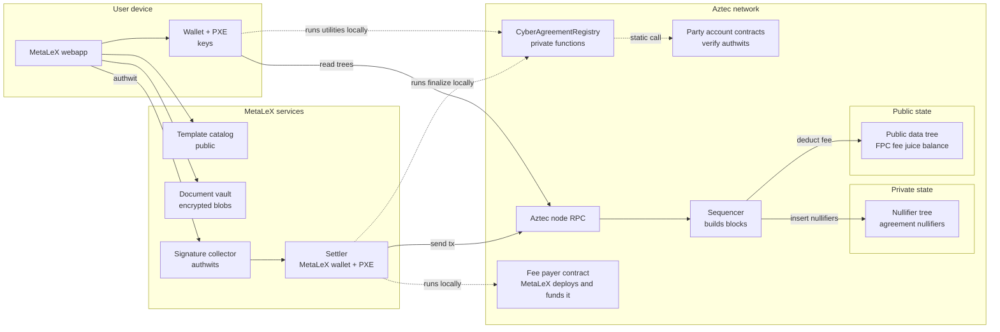
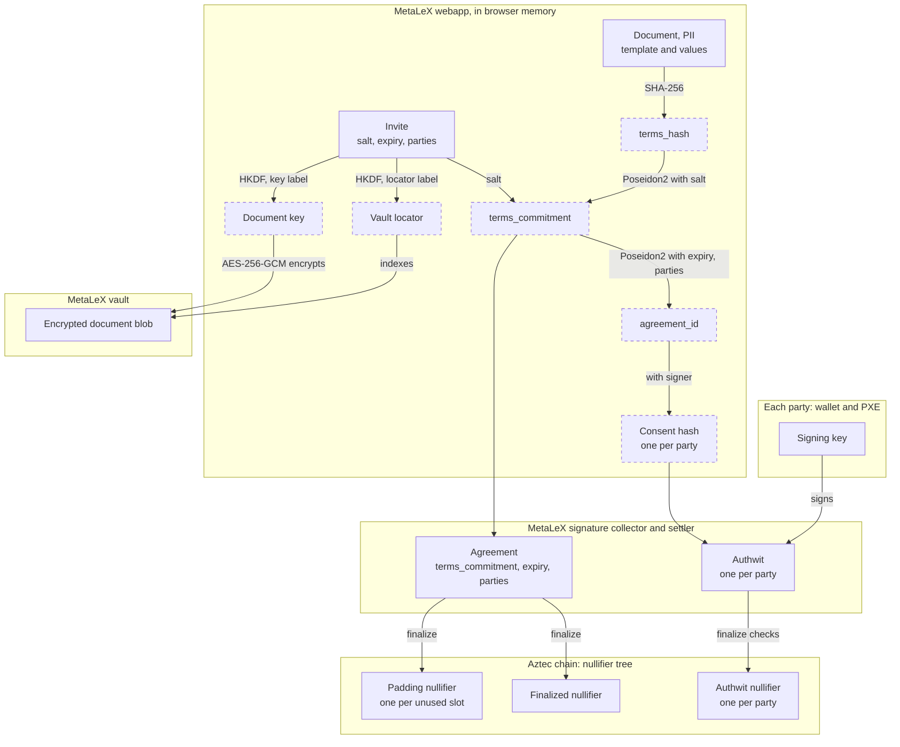

# Private Agreement Registry on Aztec: Architecture

This document describes the proof of concept (PoC) port of `src/CyberAgreementRegistry.sol` to Aztec.
The PoC supports the happy path of one agreement: every party signs offchain, and MetaLeX settles all signatures
in one private transaction (`finalize`). See [USER-FLOWS.md](USER-FLOWS.md) for the step-by-step flows.

Toolchain: Aztec 6.0.0, aztec-nr v6.0.0, Noir 1.0.0-rc.3.

## Design rules

1. The chain keeps only nullifiers. Agreement text, field values and party addresses stay offchain.
2. Each party signs offchain with a private authwit. MetaLeX collects the authwits and sends one `finalize` tx
   when all parties signed. No party needs to send a tx or hold a fee token.
3. Only the parties, and the people they share an invite with, know the salt. The MetaLeX services never get the
   salt, the terms or the document text.
4. The MetaLeX services hold no user keys.

## Components



| Component                         | Who runs it                                       | What it stores                                                            | What it can read                                                  |
|-----------------------------------|---------------------------------------------------|---------------------------------------------------------------------------|-------------------------------------------------------------------|
| `CyberAgreementRegistry` contract | Aztec network                                     | Nullifiers only (private state)                                           | Nothing after the tx                                              |
| User wallet and PXE               | User (browser embedded wallet or an Aztec wallet) | Account keys                                                              | What the user opens in it                                         |
| MetaLeX webapp                    | MetaLeX (code), user (runtime)                    | The invites that the user keeps                                           | What the user opens in it                                         |
| Template catalog                  | MetaLeX                                           | Public legal templates                                                    | Public data only                                                  |
| Document vault                    | MetaLeX                                           | AES-256-GCM document blobs, keyed by a locator                            | Locator, blob size, upload and fetch times                        |
| Signature collector               | MetaLeX                                           | Onboarded account data, `Agreement` structs without salt, authwits        | Parties, expiry, agreement id, who signed and when                |
| Settler                           | MetaLeX                                           | Its own account keys, the public signing keys of the party accounts       | The same as the collector, and the finalize status                |
| Party account contracts           | Aztec network; each user owns one                 | The signing public key, in the contract instance (`immutables_hash`)      | Nothing after the tx                                              |
| Fee payer contract (FPC)          | Aztec network; MetaLeX deploys and funds it       | Fee juice balance (public state)                                          | That a sponsored tx happened                                      |
| Aztec node RPC                    | Aztec network                                     | Chain state                                                               | Queries from each PXE (nullifier lookups, tx hashes)              |
| Sequencer                         | Aztec network                                     | Nothing; it writes tx effects into the trees                              | Tx effects: nullifiers, fee payer, fee                            |

## Data model

### Agreement (circuit input)

```noir
struct Agreement {
    terms_commitment: Field,              // hides the terms; only salt holders can open it
    expiry: u64,                          // 0 means no expiry
    party_count: u32,
    parties: [AztecAddress; MAX_PARTIES], // unused slots are zero
}
```

`MAX_PARTIES` is 4. Each party adds one private call to its account contract in the finalize tx.

The struct holds no salt and no `terms_hash`. So MetaLeX can run `finalize` and still cannot open the document.

### Derived values

| Value               | Formula                                                                                   | Where it is computed                       |
|---------------------|-------------------------------------------------------------------------------------------|--------------------------------------------|
| `terms_hash`        | `sha256(canonical JSON of the document)` reduced into the field                           | Webapp                                     |
| `terms_commitment`  | `poseidon2([terms_hash, salt], "metalex.agreement.terms.v1")`                             | Webapp, with the `terms_commitment_of` utility |
| `agreement_id`      | `poseidon2([terms_commitment, expiry, party_count, parties...], "metalex.agreement.id.v1")` | Circuit, and the `agreement_id` utility    |
| Consent hash        | `compute_inner_authwit_hash(["metalex.agreement.consent.v1", agreement_id, signer])`      | Circuit, and the `consent_hash_of` utility |
| Authwit             | The signature of the party over `poseidon2([registry, chain_id, version, consent hash])`  | Party wallet                               |
| Authwit nullifier   | `compute_authwit_nullifier(signer, consent hash)`, one per party                          | Circuit                                    |
| Padding nullifier   | `poseidon2([agreement_id, slot], "metalex.agreement.padding.v1")`, one per unused slot     | Circuit                                    |
| Finalized nullifier | `poseidon2([agreement_id], "metalex.agreement.finalized.v1")`                             | Circuit, and the `is_finalized` utility    |
| Vault locator       | `HKDF-SHA256(ikm = salt, salt = empty, info = "metalex.doc.locator.v1", 32 bytes)`        | Webapp                                     |
| Document key        | `HKDF-SHA256(ikm = salt, salt = empty, info = "metalex.doc.key.v1", 32 bytes)`            | Webapp                                     |

The consent hash holds the signer. Two parties that sign the same agreement must sign different messages. The PXE
finds an authwit by its message hash, and that hash does not hold the signer.

The PoC uses one hash for the whole document. A Poseidon Merkle root over the fields would let a party later prove
one field in a circuit without the others.

The salt is the root secret of an agreement. A holder of the salt can open the terms commitment, find the vault
blob and decrypt it. Without the salt, nobody can link the agreement id to a document. The webapp must make the
salt with a secure random source.

### Invite

The invite is what a party shares with a counterparty or an auditor. It holds the salt, the expiry and the party
addresses. With the invite and the vault blob, the webapp can rebuild the `Agreement` struct and the agreement id.

The webapp puts the invite in the URL fragment (after `#`). A browser does not send the fragment to the server, so
the MetaLeX services never receive it. A holder of the invite can read the whole document. The webapp treats each
party address in an invite as untrusted and checks that it is a valid address.

### Canonical JSON

All parties must get the same `terms_hash` from the same document. So the webapp writes the document as one fixed
JSON string before it hashes it:

- It sorts the keys of each object.
- It writes no spaces and no line breaks.
- It keeps the order of each array.
- It writes strings and numbers as `JSON.stringify` does.

The standard for this is RFC 8785, the JSON Canonicalization Scheme (JCS). The PoC function `canonicalJson` in
`scripts/e2e.ts` gives the JCS output for strings, numbers, arrays and objects. A webapp in another language must use
JCS. The same string is the plaintext of the vault blob, so a party decrypts the exact bytes that were hashed.

The document holds:

- `template`: the title, the URI and the field names, from the public catalog.
- `globalValues`: the values of the fields that apply to the whole agreement.
- `partyValues`: for each party address, the values of that party. These hold the PII.

The salt is not in the document. It is in the invite. The expiry is a field of `Agreement`. The value arrays are an
open item (see [Limits and open items](#limits-and-open-items)).

Example document:

```json
{
  "template": {
    "title": "Mutual NDA",
    "uri": "ipfs://example-template",
    "globalFields": ["effectiveDate"],
    "partyFields": ["name"]
  },
  "globalValues": ["2026-11-01"],
  "partyValues": [
    ["<Alice address>", ["Alice Corp"]],
    ["<Bob address>", ["Bob LLC"]]
  ]
}
```

Its canonical JSON, which the webapp hashes:

```text
{"globalValues":["2026-11-01"],"partyValues":[["<Alice address>",["Alice Corp"]],["<Bob address>",["Bob LLC"]]],"template":{"globalFields":["effectiveDate"],"partyFields":["name"],"title":"Mutual NDA","uri":"ipfs://example-template"}}
```

### Secrets, keys and hashes

Each box is a place where a value lives. A dashed box is a value that the webapp computes when it needs it and does
not store.



| Value                   | Kind           | Made by                               | Known to                                           | Stored at                                                     |
|-------------------------|----------------|---------------------------------------|----------------------------------------------------|---------------------------------------------------------------|
| Signing key             | Secret         | Party's wallet                        | That party                                         | Wallet                                                        |
| Salt                    | Secret         | Creator's webapp, random              | All parties, and each holder of the invite         | Inside the invite; never onchain, never at MetaLeX            |
| Document                | PII            | Creator's webapp                      | All parties, and each holder of the invite         | Plaintext only in webapp memory; ciphertext in the vault      |
| `terms_hash`            | Hash           | Webapp, SHA-256 of the document       | Each holder of the invite                          | Not stored                                                    |
| `terms_commitment`      | Hash           | Webapp, Poseidon2                     | Each holder of the invite, and MetaLeX             | In the collector                                              |
| `agreement_id`          | Hash           | Webapp and circuit, Poseidon2         | Each holder of the invite, and MetaLeX             | Collector index                                               |
| Consent hash            | Hash           | Webapp and circuit                    | The same as `agreement_id`                         | Not stored                                                    |
| Authwit                 | Signature      | Party's wallet                        | That party and MetaLeX                             | Collector, until the finalize tx                              |
| Authwit nullifier       | Hash           | Circuit                               | Public                                             | Nullifier tree                                                |
| Padding nullifier       | Hash           | Circuit                               | Public                                             | Nullifier tree                                                |
| Finalized nullifier     | Hash           | Circuit                               | Public                                             | Nullifier tree                                                |
| Vault locator           | Derived id     | Webapp, HKDF of the salt              | Each holder of the invite, and the MetaLeX vault   | Vault index                                                   |
| Document key            | Derived secret | Webapp, HKDF of the salt              | Each holder of the invite                          | Not stored                                                    |
| Encrypted document blob | Ciphertext     | Creator's webapp, AES-256-GCM         | MetaLeX stores it; only salt holders decrypt it    | MetaLeX vault                                                 |

The signing key of each party protects the account. The salt protects one agreement. Without the salt, a chain
observer cannot link the three kinds of nullifiers to each other or to an agreement.

### What goes onchain

The finalize tx was measured on a local network (see [README.md](README.md#verification)):

| Tx field                                    | Value for `finalize`                                                                   |
|---------------------------------------------|----------------------------------------------------------------------------------------|
| Nullifiers                                  | 6: the tx nullifier, one per party slot (authwit or padding), the finalized nullifier |
| Note hashes                                 | 0                                                                                      |
| Private logs                                | 0                                                                                      |
| Public logs                                 | 0                                                                                      |
| Fee payer                                   | The FPC address                                                                        |
| Expiration timestamp                        | `min(expiry, anchor + 1 day)`                                                          |
| Anchor block header, gas settings, gas used | Same for all calls to this function                                                    |

The number of nullifiers does not change with the number of parties. Each unused slot adds a padding nullifier. The
local network run measured 6 nullifiers for one party and for two parties.

## Mapping from the Solidity registry

Each row compares one concept. "Today" is `src/CyberAgreementRegistry.sol`. "Proposed" is this PoC.

| Concept                 | Today                                                                                   | Proposed                                                                                                                         |
|-------------------------|-----------------------------------------------------------------------------------------|----------------------------------------------------------------------------------------------------------------------------------|
| Template                | Today, stored onchain in `templates` (title, URI, field name arrays).                   | Proposed, an entry in the public MetaLeX catalog. The document includes it, and `terms_hash` commits to it.                      |
| Global and party values | Today, `string[]` arrays stored onchain.                                                | Proposed, fields in the encrypted document in the vault.                                                                         |
| Parties                 | Today, `address[]` stored onchain, plus `agreementsForParty`.                           | Proposed, a fixed array in the circuit input, the invite and the collector. Nothing onchain.                                     |
| Agreement id            | Today, `keccak256` over creator, template, values, parties, expiry.                     | Proposed, Poseidon2 over `terms_commitment`, expiry and parties. No creator role.                                                |
| Create                  | Today, `createBoundContract` or `createBoundContractAndSignFor` stores the agreement.   | Proposed, nothing onchain. The creator puts the document in the vault and shares the invite.                                     |
| Signature               | Today, an EIP-712 ECDSA signature for each party, checked onchain by `signContract`.    | Proposed, a private authwit for each party, made offchain. `finalize` checks each authwit, and an authwit nullifier records it.  |
| Relayer                 | Today, any relayer submits a signature with `...For`. `delegations` lets a delegate sign. | Proposed, any account can send `finalize` with the authwits. The MetaLeX settler does this.                                     |
| Finalize                | Today, the last signature sets `finalized`, or the finalizer calls `finalizeContract`.  | Proposed, one `finalize` tx after all parties signed. The finalized nullifier records it.                                        |
| Signing time            | Today, `signedAt` stores the time of each signature.                                    | Proposed, the block of the finalize tx gives the time for all parties. Only the collector knows when each party signed.         |
| Duplicate finalize      | Today, `ContractAlreadyFinalized` checks storage.                                       | Proposed, a second finalize gives the same finalized nullifier, so the network rejects the tx.                                   |
| Expiry                  | Today, `block.timestamp` checks.                                                        | Proposed, `set_expiration_timestamp(expiry)`. The network drops the finalize tx after the expiry.                                |
| Status                  | Today, `isFinalized` and `hasSigned` read storage.                                      | Proposed, the `is_finalized` utility asks the node for the finalized nullifier.                                                  |
| Events                  | Today, public `ContractCreated`, `AgreementSigned` and `ContractFinalized` logs.        | Proposed, no events. A holder of the invite reads the status from the chain.                                                     |
| Gas                     | Today, the signer or a relayer pays ETH.                                                | Proposed, the MetaLeX FPC pays the fee of the finalize tx.                                                                       |

Not in this PoC: void, open party slots, secret hash, finalizer, signer conditions, escrow signatures.

## MetaLeX privacy data layer

MetaLeX runs four services. None of them gets the salt, the terms or the document text.

### Signature collector

- At onboarding, the webapp gives the collector the address, the account instance and the signing public key of
  the user. These are public data. The settler needs them to run the authwit check of the account.
- The creator's webapp gives the collector the `Agreement` struct. The struct holds no salt.
- Each party's webapp gives the collector one authwit. The collector shows which parties signed.
- When all parties signed, the collector gives the struct and the authwits to the settler.

### Settler

- The settler is a MetaLeX account in its own wallet and PXE.
- For each party, the settler registers the account instance and stores the signing public key. The account
  contract checks that key against its `immutables_hash`. No secret of the party is needed.
- The settler sends `finalize` with the authwits, and adds the party addresses as PXE scopes. A scope lets the PXE
  read the key that it stored for that address. It gives no access to party keys.
- The authwit check of the account must read no private state of the owner. The initializerless Schnorr account
  meets this. An account that keeps its signing key in a private note does not, because only the owner can read
  that note.

### Document vault

- The webapp encrypts the document with the document key and uploads it at the vault locator.
- The vault cannot compute the agreement id, because it does not have the salt.
- The vault is also the backup of the legal text. A party needs the text to know what it signed.

### Fee payer contract

- The FPC is an onchain contract on Aztec. MetaLeX deploys it and funds it with fee juice. Its balance is public
  state.
- The FPC pays the fee of the finalize tx, so no user needs a fee token. The tx shows the FPC as fee payer.
- The local network test uses the canonical SponsoredFPC. A mainnet FPC must limit its use, for example to the
  settler account. This PoC does not include that FPC.

### Node RPC

Each PXE asks a node for nullifier status, tx effects and block data. The node sees these queries. MetaLeX can run a
node for its users. A user who wants more privacy can use a separate node.

## Privacy analysis

| Viewer                                | What it learns                                                                                                                  | What it does not learn                                     |
|---------------------------------------|---------------------------------------------------------------------------------------------------------------------------------|------------------------------------------------------------|
| Chain observer                        | That some tx emitted 6 nullifiers, its fee payer, its time, and an expiry when the expiry is less than one day after the anchor | Contract called, parties, party count, terms, agreement id |
| MetaLeX (collector and settler)       | Parties, expiry, agreement id, who signed and when, the finalize status                                                         | Salt, terms, document text                                 |
| MetaLeX (vault)                       | Locator, blob size, upload and fetch times                                                                                      | Agreement id, parties, document text                       |
| MetaLeX (FPC)                         | That a sponsored tx happened                                                                                                    | Which function or user, from the FPC alone                 |
| Node operator                         | Nullifier lookups and tx hash lookups from a PXE, and the IP of the PXE                                                         | Terms or parties, unless it can link the lookups           |
| Counterparty, or auditor with invite  | All data of that agreement and its finalize status                                                                              | Other agreements of the parties                            |

Notes:

- A party can prove the agreement to a third party with the invite. The verifier opens the document, rebuilds the
  agreement id and checks the finalized nullifier onchain.
- The collector can link parties, because one agreement lists all of them.

## Limits and open items

- `MAX_PARTIES` is 4. More parties need more private calls in the finalize tx, or a commitment to the party list.
- A party cannot withdraw an authwit before the finalize tx. Only the expiry limits it. A void flow needs a registry
  function that a party can call to block the finalize.
- The settler works only with accounts whose authwit check reads no private state of the owner.
- The webapp must keep the invite for the user. If the user loses the invite, the user cannot open the document.
  A durable store for invites is a design item.
- The MetaLeX FPC with use limits is a design item. The PoC uses the test SponsoredFPC.
- Counsel must confirm that an authwit is acceptable as an electronic signature. The PoC keeps no ECDSA signature
  artifact.
- The PoC is not deployed on Aztec mainnet. It has no independent review.
- No need to store "globalValues" and "partyValues" as string arrays in the canonical JSON. That was a legacy structure to fit EVM; we no longer subject to such limitation and a JSON can have dynamic structures. Find a more native way of storing the info
