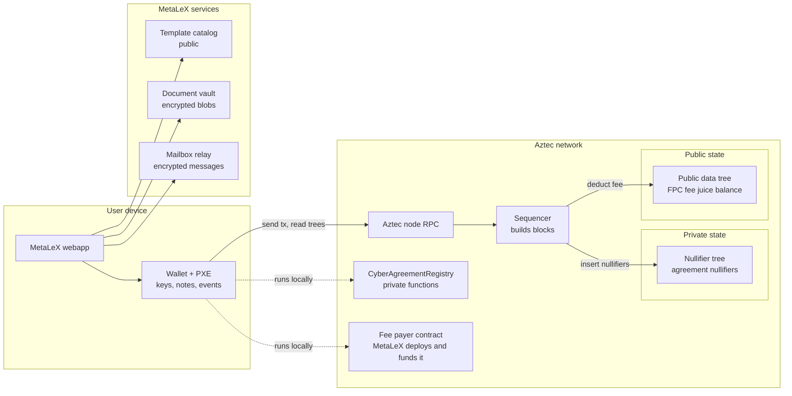
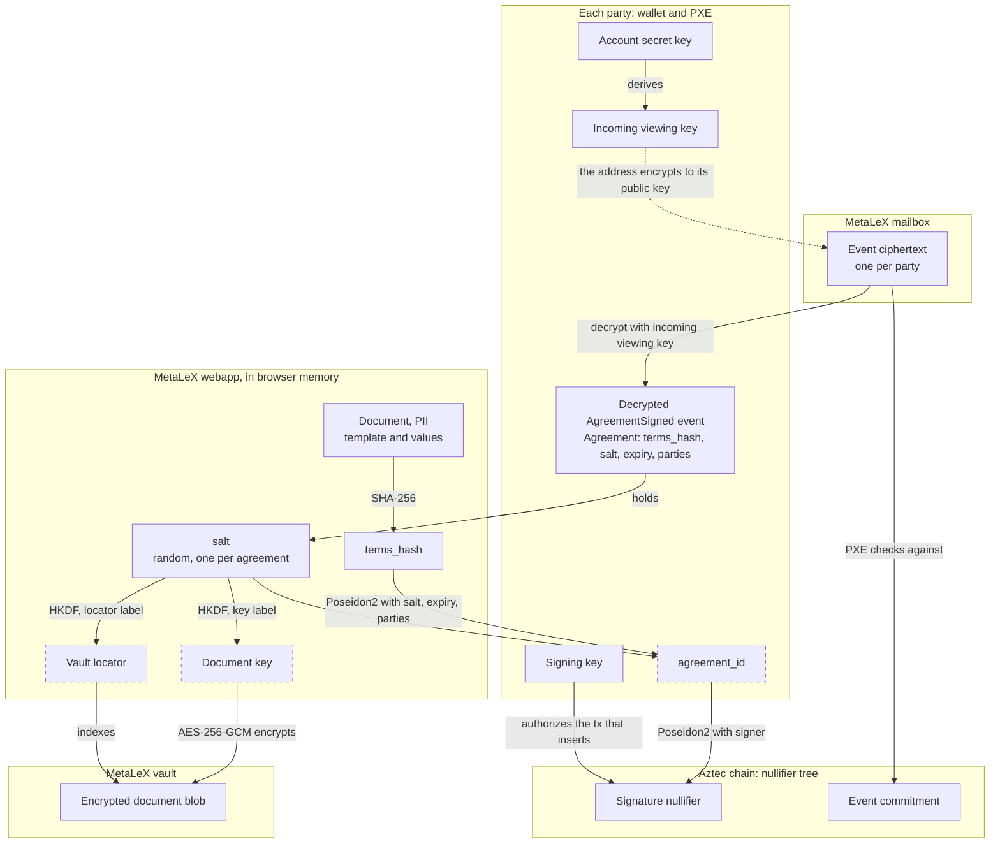

# Private Agreement Registry on Aztec: Architecture

This document describes the proof of concept (PoC) port of `src/CyberAgreementRegistry.sol` to Aztec.
The PoC supports one flow: `create_bound_contract_and_sign_for`. The creator makes an agreement and signs it in
one private transaction. See [USER-FLOWS.md](USER-FLOWS.md) for the step-by-step flows.

Toolchain: Aztec 6.0.0, aztec-nr v6.0.0, Noir 1.0.0-rc.3.

## Design rules

1. The chain keeps only what the protocol needs to prevent a double signature and to prove a signature later.
   Agreement text, field values and party addresses stay offchain.
2. Each party keeps its own copy of the agreement data in its own PXE (the private execution environment in the
   wallet). The registry sends that copy as an encrypted private event, with offchain delivery.
3. MetaLeX runs the offchain services that make this easy to use. These services store and forward ciphertext
   only. They do not hold user keys.

## Components



| Component                         | Who runs it                                       | What it stores                                          | What it can read                                    |
|-----------------------------------|---------------------------------------------------|---------------------------------------------------------|-----------------------------------------------------|
| `CyberAgreementRegistry` contract | Aztec network                                     | Nullifiers only (private state)                         | Nothing after the tx                                |
| User wallet and PXE               | User (browser embedded wallet or an Aztec wallet) | Keys, decrypted `AgreementSigned` events                | All agreements of that user                         |
| MetaLeX app                       | MetaLeX (code), user (runtime)                    | Nothing that the user does not keep                     | What the user opens in it                           |
| Template catalog                  | MetaLeX                                           | Public legal templates                                  | Public data only                                    |
| Document vault                    | MetaLeX                                           | AES-256-GCM document blobs, keyed by a locator          | Locator, blob size, upload and fetch times          |
| Mailbox relay                     | MetaLeX                                           | Encrypted offchain messages, keyed by recipient address | Recipient address, sender session, timing           |
| Fee payer contract (FPC)          | Aztec network; MetaLeX deploys and funds it       | Fee juice balance (public state)                        | That a sponsored tx happened                        |
| Aztec node RPC                    | Aztec network                                     | Chain state                                             | Queries from the PXE (nullifier lookups, tx hashes) |
| Sequencer                         | Aztec network                                     | Nothing; it writes tx effects into the trees            | Tx effects: nullifiers, fee payer, fee              |

## Data model

### Agreement (circuit input and event payload)

```noir
struct Agreement {
    terms_hash: Field,                    // commits to the offchain document
    salt: Field,                          // random secret that the parties share
    expiry: u64,                          // 0 means no expiry
    party_count: u32,
    parties: [AztecAddress; MAX_PARTIES], // parties[0] is the creator; unused slots are zero
}
```

`MAX_PARTIES` is 4. One private event message holds at most 11 fields (`MAX_EVENT_SERIALIZED_LEN` in aztec-nr).
`AgreementSigned { agreement, signer }` uses 9 of them.

### Derived values

| Value               | Formula                                                                                     | Where it is computed                    |
|---------------------|---------------------------------------------------------------------------------------------|-----------------------------------------|
| `terms_hash`        | `sha256(canonical JSON of the document)` reduced into the field                             | App                                     |
| `agreement_id`      | `poseidon2([terms_hash, salt, expiry, party_count, parties...], "metalex.agreement.id.v1")` | Circuit, and the `agreement_id` utility |
| Signature nullifier | `poseidon2([agreement_id, signer], "metalex.agreement.signature.v1")`                       | Circuit                                 |
| Vault locator       | `HKDF-SHA256(ikm = salt, salt = empty, info = "metalex.doc.locator.v1", 32 bytes)`          | App                                     |
| Document key        | `HKDF-SHA256(ikm = salt, salt = empty, info = "metalex.doc.key.v1", 32 bytes)`              | App                                     |

The PoC uses one hash for the whole document. A Poseidon Merkle root over the fields would let a party later prove
one field in a circuit without the others.

The salt is the root secret of an agreement. A holder of the salt and the other inputs can find the vault blob,
decrypt it and compute the signature nullifiers. Without the salt, nobody can link a nullifier to an agreement.
The app must make the salt with a secure random source.

### Canonical JSON

All parties must get the same `terms_hash` from the same document. So the app writes the document as one fixed
JSON string before it hashes it:

- It sorts the keys of each object.
- It writes no spaces and no line breaks.
- It keeps the order of each array.
- It writes strings and numbers as `JSON.stringify` does.

The standard for this is RFC 8785, the JSON Canonicalization Scheme (JCS). The PoC function `canonicalJson` in
`scripts/e2e.ts` gives the JCS output for strings, numbers, arrays and objects. An app in another language must use
JCS. The same string is the plaintext of the vault blob, so a party decrypts the exact bytes that were hashed.

The document holds:

- `template`: the title, the URI and the field names, from the public catalog.
- `globalValues`: the values of the fields that apply to the whole agreement.
- `partyValues`: for each party address, the values of that party. These hold the PII.

The salt and the expiry are not in the document. They are fields of `Agreement`. The value arrays are an open item
(see [Limits and open items](#limits-and-open-items)).

Example document:

```json
{
  "template": {
    "title": "Mutual NDA",
    "uri": "ipfs://example-template",
    "globalFields": ["effectiveDate"],
    "partyFields": ["name"]
  },
  "globalValues": ["2026-11-01"],
  "partyValues": [
    ["<Alice address>", ["Alice Corp"]],
    ["<Bob address>", ["Bob LLC"]]
  ]
}
```

Its canonical JSON, which the app hashes:

```text
{"globalValues":["2026-11-01"],"partyValues":[["<Alice address>",["Alice Corp"]],["<Bob address>",["Bob LLC"]]],"template":{"globalFields":["effectiveDate"],"partyFields":["name"],"title":"Mutual NDA","uri":"ipfs://example-template"}}
```

### Secrets, keys and hashes

Each box is a place where a value lives. A dashed box is a value that the app computes when it needs it and does
not store.



| Value                   | Kind                    | Made by                              | Known to                                        | Stored at                                                        |
|-------------------------|-------------------------|--------------------------------------|-------------------------------------------------|------------------------------------------------------------------|
| Account secret key      | Secret                  | Party's wallet                       | That party                                      | Wallet                                                           |
| Incoming viewing key    | Secret                  | Derived from the account secret key  | That party, and anyone the party gives it to    | Wallet and PXE                                                   |
| Signing key             | Secret                  | Party's wallet                       | That party                                      | Wallet                                                           |
| Salt                    | Secret                  | Creator's webapp, random             | All parties                                     | Inside each event ciphertext and each party's PXE; never onchain |
| Document                | PII                     | Creator's webapp                     | All parties                                     | Plaintext only in webapp memory; ciphertext in the vault         |
| `terms_hash`            | Hash                    | Webapp, SHA-256 of the document      | All parties                                     | Inside the event                                                 |
| `agreement_id`          | Hash                    | Circuit and utility, Poseidon2       | Each holder of the `Agreement` struct           | Not stored                                                       |
| Signature nullifier     | Hash                    | Circuit, Poseidon2                   | Public                                          | Nullifier tree                                                   |
| Event ciphertext        | Ciphertext              | Sender's PXE, one per party          | Each party can decrypt its own copy             | MetaLeX mailbox, for a set time                                  |
| Event commitment        | Hash                    | Protocol, one per tx                 | Public                                          | Nullifier tree                                                   |
| Vault locator           | Derived id              | Webapp, HKDF of the salt             | All parties and the MetaLeX vault               | Vault index                                                      |
| Document key            | Derived secret          | Webapp, HKDF of the salt             | All parties                                     | Not stored                                                       |
| Encrypted document blob | Ciphertext              | Creator's webapp, AES-256-GCM        | MetaLeX stores it; only salt holders decrypt it | MetaLeX vault                                                    |

The three keys of each party protect the account. The salt protects one agreement. The PXE also keeps the decrypted
event, so a party can open the document again without the mailbox.

### What goes onchain

The PoC tx was measured on a local network (see [README.md](README.md#verification)):

| Tx field                                    | Value for `create_bound_contract_and_sign_for`                       |
|---------------------------------------------|----------------------------------------------------------------------|
| Nullifiers                                  | 3: the tx nullifier, the signature nullifier, the event commitment   |
| Note hashes                                 | 0                                                                    |
| Private logs                                | 0                                                                    |
| Public logs                                 | 0                                                                    |
| Fee payer                                   | The FPC address when sponsored. The user address when the user pays. |
| Expiration timestamp                        | `min(expiry, anchor + 1 day)`                                        |
| Anchor block header, gas settings, gas used | Same for all calls to this function                                  |

The number of nullifiers does not change with the number of parties. One event commitment covers all recipients.
A per-party note would add one note hash for each party and show the party count.

## Mapping from the Solidity registry

Each row compares one concept. "Today" is `src/CyberAgreementRegistry.sol`. "Proposed" is this PoC.

| Concept                 | Today                                                                               | Proposed                                                                                                                       |
|-------------------------|-------------------------------------------------------------------------------------|--------------------------------------------------------------------------------------------------------------------------------|
| Template                | Today, stored onchain in `templates` (title, URI, field name arrays).               | Proposed, an entry in the public MetaLeX catalog. The document includes it, and `terms_hash` commits to it.                    |
| Global and party values | Today, `string[]` arrays stored onchain.                                            | Proposed, fields in the encrypted document in the vault.                                                                       |
| Parties                 | Today, `address[]` stored onchain, plus `agreementsForParty`.                       | Proposed, a fixed array in the circuit input and in each party's event. Nothing onchain.                                       |
| Agreement id            | Today, `keccak256` over creator, template, values, parties, expiry.                 | Proposed, Poseidon2 over `terms_hash`, salt, expiry and parties. The creator is `parties[0]`.                                  |
| Signature               | Today, an EIP-712 ECDSA signature, checked onchain. `signedAt` stores the time.     | Proposed, the account contract authorizes the tx. A nullifier records the consent. The block of that nullifier gives the time. |
| `...For` and delegation | Today, any relayer submits a signature. The `delegations` map lets a delegate sign. | Proposed, `#[authorize_once]`: the signer calls with nonce 0, or a contract in the signer's tx uses a one-time authwit.        |
| Duplicate creation      | Today, `ContractAlreadyExists` checks storage.                                      | Proposed, the second signature nullifier is a duplicate, so the network rejects the tx.                                        |
| Expiry                  | Today, `block.timestamp` checks.                                                    | Proposed, `set_expiration_timestamp(expiry)`. The network drops the tx after the expiry.                                       |
| Events                  | Today, public `ContractCreated` and `AgreementSigned` logs.                         | Proposed, one private `AgreementSigned` event, encrypted to each party, delivered offchain.                                    |
| Gas                     | Today, the signer or a relayer pays ETH.                                            | Proposed, the MetaLeX FPC pays the fee.                                                                                        |

Not in this PoC: counterparty signature, void, finalize, open party slots, secret hash, finalizer, signer
conditions, escrow signatures.

## MetaLeX privacy data layer

Aztec offchain delivery gives no delivery guarantee. The sender can skip it, and nobody stores the message. MetaLeX
closes this gap with two stores and one sponsor. Each of them sees only ciphertext.

### Mailbox relay

- The sender wallet gets `offchainMessages` from the send result. Each message holds the recipient address, the
  ciphertext, the contract address and the anchor block timestamp.
- The app uploads the messages with the tx hash. The mailbox keeps them by recipient.
- The recipient app downloads its messages and calls `offchain_receive` on the registry in its own PXE. The PXE
  finds the tx onchain, checks the event commitment and stores the event.
- Late delivery works. The PXE processes a message whenever its tx is onchain. The inbox drops a message only if
  its tx is not found within `MAX_TX_LIFETIME + 2h` of the anchor.
- The mailbox keeps messages after delivery for a set time. A user who loses a device can sync again.

### Document vault

- The app encrypts the document with the document key and uploads it at the vault locator.
- The vault cannot compute the agreement id, because it does not have the salt.
- The vault is also the backup of the legal text. A party needs the text to know what it signed.

### Fee payer contract

- The FPC is an onchain contract on Aztec. MetaLeX deploys it and funds it with fee juice. Its balance is public
  state.
- The MetaLeX FPC pays the fee, so users need no fee token. The tx shows the FPC as fee payer, not the user.
- The local network test uses the canonical SponsoredFPC. A mainnet FPC must limit its use, for example by a
  quota per account or by a check of the target function. This PoC does not include that FPC.

### Node RPC

The PXE asks a node for nullifier status, tx effects and block data. The node sees these queries. MetaLeX can run a
node for its users. A user who wants more privacy can use a separate node.

## Privacy analysis

| Viewer                      | What it learns                                                                                                                  | What it does not learn                                     |
|-----------------------------|---------------------------------------------------------------------------------------------------------------------------------|------------------------------------------------------------|
| Chain observer              | That some tx emitted 3 nullifiers, its fee payer, its time, and an expiry when the expiry is less than one day after the anchor | Contract called, parties, party count, terms, agreement id |
| MetaLeX (mailbox and vault) | Which addresses got messages from one upload, so who deals with whom, and when. Blob sizes.                                     | Terms, salt, agreement id, signature status                |
| MetaLeX (FPC)               | That a sponsored tx happened                                                                                                    | Which function or user, from the FPC alone                 |
| Node operator               | Nullifier lookups and tx hash lookups from a PXE, and the IP of the PXE                                                         | Terms or parties, unless it can link the lookups           |
| Counterparty                | All agreement data and the signature status of each party                                                                       | Other agreements of the creator                            |

Notes:

- The mailbox can link parties because one upload has all recipients and the tx hash. An app can upload each
  message in a separate session with a delay, and put the tx hash inside an envelope encrypted to the recipient.
- A delegated call adds one authwit nullifier. That tx shape differs from a direct call.
- A party can prove a signature to a third party by disclosure of the agreement data. The verifier recomputes the
  nullifier and checks it onchain. This also discloses the salt.

## Limits and open items

- `MAX_PARTIES` is 4 because of the event size. More parties need a commitment to the party list and a membership
  proof in the circuit.
- The MetaLeX FPC with use limits is a design item. The PoC uses the test SponsoredFPC.
- Counsel must confirm that an account-authorized nullifier is acceptable as an electronic signature record.
  The PoC keeps no ECDSA signature artifact.
- The PoC is not deployed on Aztec mainnet. It has no independent review.
- No need to store "globalValues" and "partyValues" as string arrays in the canonical JSON. That was a legacy structure to fit EVM; we no longer subject to such limitation and a JSON can have dynamic structures. Find a more native way of storing the info