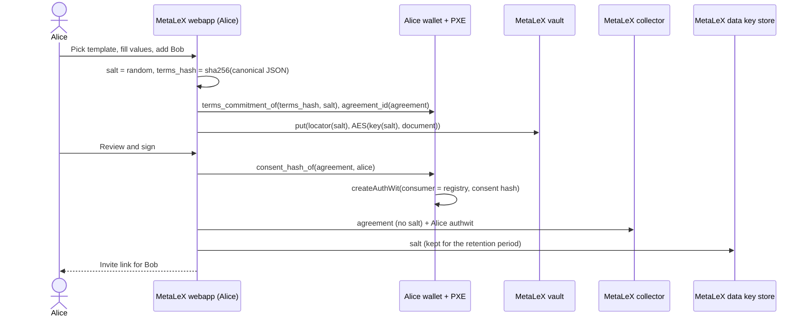
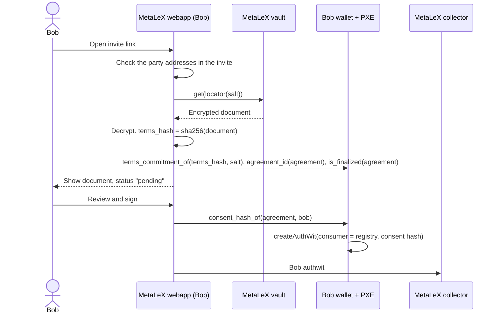
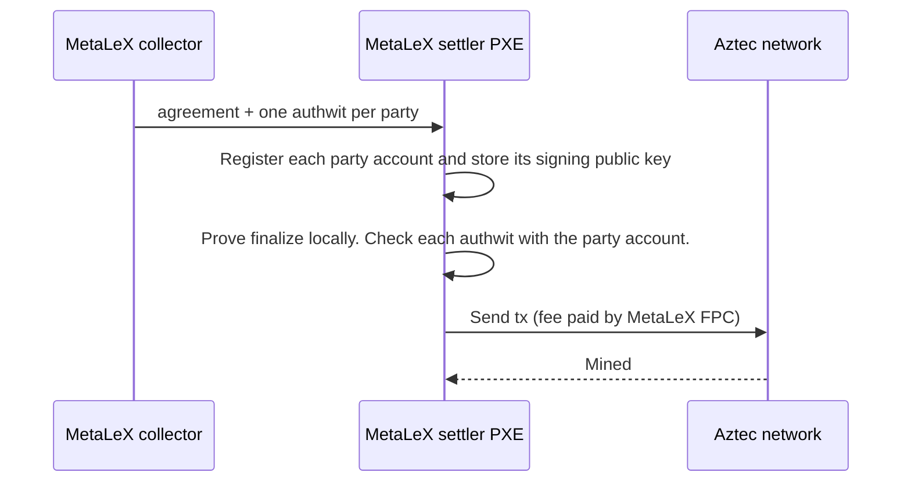

# Private Agreement Registry on Aztec: User Flows

The flows below use two parties and one auditor. Alice drafts the agreement. Bob is the counterparty. Each party has
its own wallet and PXE. MetaLeX runs the document vault, the data key store, the signature collector and the
settler. Flows 2 to 7 run in `scripts/e2e.ts` on a local network. The PoC has no login, so a request to the data
key store names its user. See [ARCHITECTURE.md](ARCHITECTURE.md) for the components.

## 1. Onboarding

1. The user signs in to the MetaLeX webapp (Privy). The webapp makes an Aztec account in an embedded wallet in the
   browser, or it connects to an Aztec wallet that the user has. The login links the email of the user to the
   address.
2. The keys stay on the user device. MetaLeX never gets them.
3. The webapp gives the signature collector the address, the account instance and the signing public key of the
   user. These are public data.
4. The webapp shows the Aztec address of the user. The user shares it with counterparties.

The creator must know the address of each party before the draft, because the parties are part of the agreement id.

## 2. Draft and sign (Alice)

PII in this flow: the document stays in Alice's browser as plaintext. The vault gets only ciphertext. The collector
gets the party addresses, the expiry and the time that Alice signed. The data key store gets the salt, so MetaLeX can
read the agreement until the end of the retention period.

Alice sends the invite link to Bob. The invite holds the salt, the expiry and the party addresses. The webapp puts
it in the URL fragment, so the link does not send it to the MetaLeX servers.

Nothing goes onchain in this flow. Alice sends no tx.

## 3. Review and sign (Bob)

PII in this flow: Bob's browser decrypts the document. The vault sees a fetch of a blob. The collector gets the
time that Bob signed.

Bob signs the agreement id that he computed himself from the document. If the vault blob or the invite is wrong,
Bob gets a different agreement id. Then his authwit is for a different agreement, and `finalize` fails.

## 4. Settle (MetaLeX)

PII in this flow: the settler uses the party addresses and public keys that the collector already has. The tx holds
no PII. The chain sees only 6 nullifiers and the FPC as fee payer.

What the circuit checks:

- The party list has one valid form: 1 to 4 parties, no zero address, no duplicate, unused slots are zero.
- `terms_commitment` is not zero.
- Each party authorized its consent hash for this agreement id, to this registry, on this chain.
- When `expiry` is not zero, the tx must be mined before `expiry`.
- The finalized nullifier is new. A second finalize of the same agreement fails.

## 5. View the agreement (party or auditor)

1. A party gives the invite link to the auditor.
2. The webapp of the auditor reads the invite, fetches the document from the vault and decrypts it.
3. The webapp computes the agreement id, then calls the `is_finalized(agreement)` utility. No tx is sent. The
   auditor needs no Aztec account.
4. The webapp shows the document and the status "finalized". To show the time, the webapp finds the block of the
   finalized nullifier.

PII in this flow: the auditor gets all PII of the agreement from the invite and the vault blob. The vault sees a fetch.
The node sees the queried nullifier and the IP of the auditor. It cannot link the nullifier to an agreement without
the salt.

## 6. Recovery

- The account keys restore the wallet on a new device.
- During the retention period, the webapp gets the salt of each agreement of the user from the MetaLeX data key
  store, and the expiry and the parties from the collector. With these, the user opens the document from the vault
  and reads the status from the chain.
- After the retention period, the data key store has no salt. The vault still keeps the encrypted document. The
  user opens it with its own copy of the invite, or asks a counterparty to send the invite link again.

## 7. Withdraw consent (party)

1. Before the settler sends `finalize`, a party opens the agreement and withdraws its consent.
2. The webapp calls `withdraw_consent(agreement)` from the party account. The party sends this tx. The FPC pays the
   fee.
3. The tx emits the authwit nullifier of that party for this agreement. A later `finalize` fails.
4. To agree again, the parties make a new agreement with a new salt.

PII in this flow: the tx shows 2 nullifiers and the fee payer. It does not show the agreement or the party. The
withdraw tx must be mined before the finalize tx. The PoC script runs this flow; the web app has no button for it.
