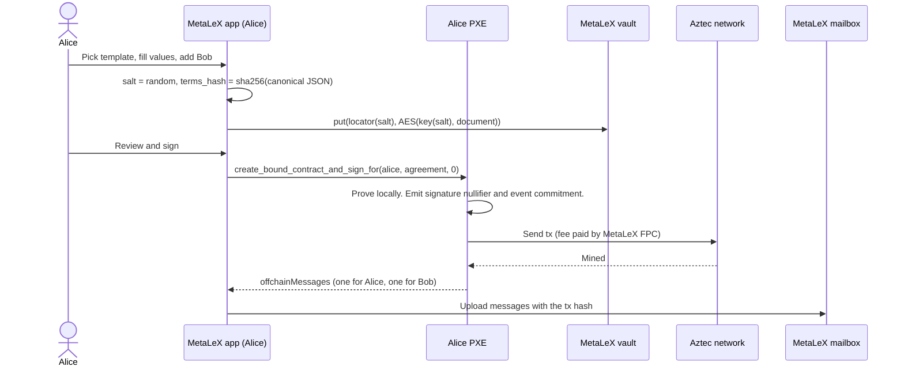
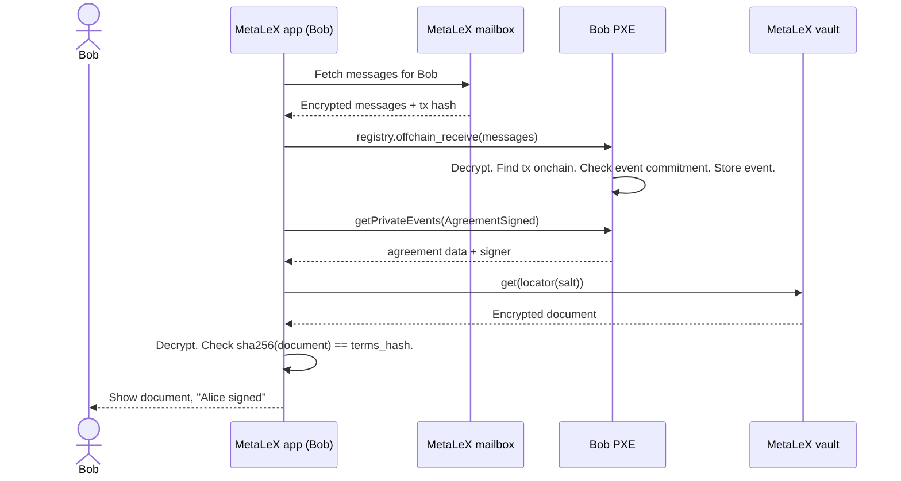

# Private Agreement Registry on Aztec: User Flows

The flows below use two users. Alice creates the agreement. Bob is the counterparty. Each user has an own wallet
and PXE. Flows 2 to 5 run in `scripts/e2e.ts` on a local network. See [ARCHITECTURE.md](ARCHITECTURE.md) for the
components.

## 1. Onboarding

1. The user opens the MetaLeX app. The app makes an Aztec account in an embedded wallet in the browser, or it
   connects to an Aztec wallet that the user has.
2. The keys stay on the user device. MetaLeX never gets them.
3. The app shows the Aztec address of the user. The user shares it with counterparties, for example by an invite
   link.

The creator must know the address of each party before creation, because the parties are part of the agreement id.

## 2. Create and sign (creator)

What the circuit checks:

- `parties[0]` is the signer. The signer is the caller, or the signer gave an authwit.
- The party list has one valid form: 1 to 4 parties, no zero address, no duplicate, unused slots are zero.
- `terms_hash` is not zero.
- When `expiry` is not zero, the tx must be mined before `expiry`.
- The signature nullifier is new. A second creation of the same agreement fails.

## 3. Receive and review (counterparty)

The app shows the document only when the hash matches. A wrong vault blob or a wrong message fails this check.

## 4. Check a signature

Any holder of the agreement data can check a signature:

1. The app calls the `is_signed(agreement, signer)` utility in the PXE. No tx is sent.
2. The utility computes the signature nullifier and asks the node if it exists.
3. To show the signing time, the app finds the block of that nullifier.

The node sees the queried nullifier. It cannot link the nullifier to an agreement without the salt.

## 5. Recovery

- PXE data is local. A user on a new device makes the account again from the same keys.
- The app fetches the mailbox again and calls `offchain_receive` for each stored message. The PXE stores the
  events again.
- The vault still holds the documents.

## 6. Call from another contract (authwit)

A MetaLeX contract that runs in the signer's tx can call `create_bound_contract_and_sign_for(signer, agreement,
nonce)` with a nonce that is not zero. The signer approves this exact call with a one-time authwit. The authwit
check runs in the signer's account contract, so it must run in the signer's PXE. A remote relayer cannot use this
path. With sponsored fees, the signer has no need for a relayer.

## Next flows (not in this PoC)

- Counterparty signature: Bob calls a `sign_for(signer, agreement, nonce)` function. It checks that Bob is in
  `parties`, emits his signature nullifier and sends `AgreementSigned` to all parties.
- Completion: the last signer proves that the nullifiers of all other parties exist, and emits a completion
  nullifier.
