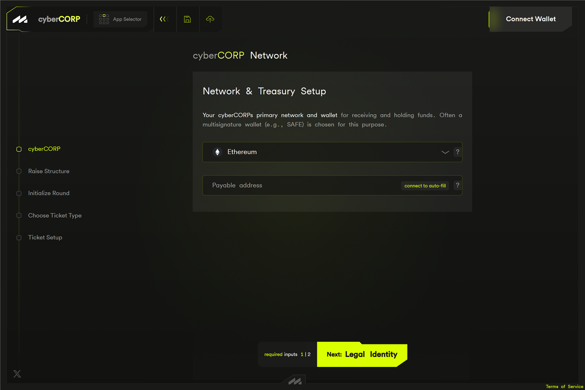

# Run your company

The cyberCORPs app (`cybercorps.metalex.tech`) is where founders and
officers run a company once it has a cyberCORP, its public onchain
company record. With a company selected, a sidebar on the left lists its
areas:

* **mission control** shows what is true about the company now and what needs action.
* **Incorporation Hub** holds the onchain formation record and founding documents.
* **Documents** collects formation mail, notices and filings, with links to boardRoom and cyberSign.
* **boardRoom** manages officers, governance documents and board approvals.
* **capTable** shows tokenized and untokenized positions in one cap table.
* **grants** manages equity awards (options, RSUs, restricted stock) with onchain vesting.
* **cyberRaise** opens your raises in [cyberRAISE](cyberraise.md).
* **Tokenization Hub** configures, issues and manages the company's LETs and scrip.
* **cyberSign** opens MetaLeX's signing app, where you sign and countersign the company's agreements.

The sidebar also has **cyberTrade**, where you explore secondary
opportunities, publish a listing or sell a position, and, as its last
item, [**Company settings**](#company-settings).

Hovering a sidebar item shows a short description of the area. The
larger areas have their own guides: [the boardRoom](boardroom.md),
[the cap table](captable.md) and its
[records, modeling and compliance tools](captable-tools.md),
[grants](grants.md), the [Tokenization Hub](tokenization-hub.md) and
[cyberSign](cybersign.md). Fundraising rounds are created and run in
[cyberRAISE](cyberraise.md).

Stakeholders join through invitation links from the cap table's
**More → Invitations** panel. Claiming one attaches the stakeholder's wallet to
their record and opens **My holdings**, where they see their own
positions, Ledger Entry Tokens (LETs), documents and grants.
[For holders](holders.md) covers that side of the app.

## Bring an existing company onchain

**Set up your company** on the app's start screen leads to one
question: **Has your company already been legally formed?** (as a
Delaware corporation, an LLC and so on).

* **Yes**: **Set up existing company on MetaLeX** brings the company
  onchain free of charge, apart from the network fee. One wallet
  transaction creates its public onchain company record, through the
  wizard below.
* **No**: **Form a company** forms an LLC or C-Corp for a flat \$1,000
  in USDC, with a choice of an onchain or offchain-only company record. See
  [Form a company](formation.md).

The setup wizard has three steps and saves your progress as you go.

1. **Network**: under **Network & Treasury Setup**, choose the chain
   (see [Network availability](README.md#network-availability)) and the *payable address* that receives
   payments for the company. A Safe multisig is recommended, and an
   auto-fill button can insert your connected wallet.
2. **Legal Identity**: the **Founder identity** gives the founder or
   officer's name and title. It is always public, and the founder's
   address holds the company's primary admin authority. **Identity** gives the
   cyberCORP name, a primary contact (Telegram, X, email or phone), the
   legal entity type and the jurisdiction of formation.
3. **Public Profile**: a description, a profile image, and website,
   whitepaper and document links.

**Deploy cyberCORP** sends the onchain transaction. When it confirms,
the company exists onchain.

> For the onchain records to be the company's securities ledger, the
> company's governing documents must designate the onchain system as that
> ledger. MetaLeX provides templates for this. Involve your counsel.

> **Under the hood.** **Deploy cyberCORP** calls the protocol's
> [`CyberCorpFactory`](../reference/factories.md), which deploys your
> [`CyberCorp`](../reference/contracts/CyberCorp.md) contract, its
> issuance, deal and round managers, and a `BorgAuth` access-control
> contract in one transaction. The founder identity address becomes an
> officer in [BorgAuth](../reference/access-control.md). The
> contract-level walkthrough is
> [Incorporate a cyberCORP](../how-to/incorporate-a-cybercorp.md), and
> [Constitutive vs. pointer tokenization](../explanation/constitutive-vs-pointer.md)
> explains how the chain can be the securities ledger.

To add another company later, use **Form a new company** in the
Incorporation Hub, or **Setup your cyberCORP** in the cyberCORP
selector, which restarts the onboarding choice.

## Company ENS identity and public documents

Eligible companies can have a managed ENS name under `cybercorps.eth`.
New formation offers the
name with an opt-out; existing companies are not automatically backfilled.
In [Company settings](#company-settings), section **ENS name**, a current
company authority can choose **Claim ENS name** and sign the request.
Mission control shows an active name on one line below the company name,
with **Copy** and **Public company record**. If the company has no name,
that line has the link **Claim an ENS name**, which opens the **ENS name**
section. Registration runs in the background. A reserved or pending name
is not an active name; follow the status and next-step links.

The name identifies the company and its public document home. **It is not
a payment address.** MetaLeX operates the naming service and has operator
write power. The company's app permissions are checked against its source
chain; they are not an ENS smart-contract restriction on the operator.
Continued naming requires canonical protocol eligibility. Older canonical
versions remain eligible without a forced upgrade. A notice, a suspension
review and reinstatement are separate states, with a contact route in the
**ENS name** section of Company settings.

**Documents** provides the public-document controls. Review the public
publication consent before submitting a disclosure: anyone can download a
published copy, and an IPFS copy cannot be made private again by removing
its listing. Approved final public formation filings can be processed
automatically; documents of an unknown type need staff review. The public
company page lists published documents and their hashes. Private packet
signatures and invitations do not become public merely because the company
has an ENS name.

## mission control

**mission control** shows the live company record. The company name is
at the top, with a **Company settings** button beside it. Below the name,
one line shows the company's ENS name with **Copy** and **Public company
record**, or the link **Claim an ENS name** (see
[Company ENS identity and public documents](#company-ens-identity-and-public-documents)).
The company profile, the full ENS controls, related companies and the
officer settings are in [Company settings](#company-settings).

If a new round or deal of the company waits for a wallet or a Safe, an
officer wallet sees it under **Pending rounds and deals**. Then comes the
operations dashboard, built from the same data as the cap table:

1. **Tiles.** The first tile, **Open tasks**, counts the open tasks and
   opens the **Tasks and reminders** card. The tiles **Fully diluted**,
   **Stakeholders** and **Capital recorded** show whole numbers and open
   the cap table. Hold the pointer on **Fully diluted** or **Capital
   recorded** to see the exact value.
2. **Tasks and reminders** collects what needs action. Each task has a
   label. Tasks with the label **Act now** come first, then **Review**,
   then **Next**.
3. **Recent activity** shows the five latest rows. **Show N more** shows
   the rest.
4. A **Fundraising** row shows the latest round and the total raised
   through cyberRaise, for a company that has a round.
5. **Equity plan utilization**, **Top stakeholders by fully diluted
   ownership** and **Project token** follow.

The tasks include:

* **Contract upgrades.** When any of the company's contracts differs
  from the reference implementation its factory publishes, a task reads
  **Contract upgrade available** (or **N contract upgrades
  available**), names the contracts and opens the Upgrade page. This is
  how an existing company's owners learn that a newer protocol release,
  such as v5, is available to them. If the company runs v5 and older
  contracts side by side, the task reads **Finish the v5 upgrade** and
  has the label **Act now**, because deals, rounds and issuance are
  paused until the upgrade is complete. If the app cannot run the
  upgrade for the company, the task reads **Contract upgrade needs
  MetaLeX** and gives the reason. See
  [Upgrade an existing company to v5](#upgrade-an-existing-company-to-v5).
* **LET contract migrations.** After the upgrade, **Migrate N LET
  contracts after the v5 upgrade** stays open until each upgraded LET
  contract has its holder counters, legal-owner index and holder tally,
  and **Set acquisition and issue dates of pre-upgrade lots** stays open
  until those dates are set. Both open the Upgrade page.
* **Formation steps.** A formation in progress surfaces here (payment,
  filing, signatures, replacement company names, officer publishing and
  setup steps) until it is complete. See [Form a company](formation.md).
* **Annual reports.** For a company formed through the app, notices
  such as **Annual report due in N days** or **Annual report overdue**
  link to the [annual reports](formation.md#file-annual-reports) panel.
* **Cap table and compliance.** Failed cap table checks, draft
  securities waiting, valuation (FMV) and 83(b) reminders, project-token
  setup, and stakeholders not yet onboarded.
* **Company settings.** **Claim an ENS name** and **ENS eligibility
  notice** open the **ENS name** section. **Confirm a company relation**
  appears when an owner of another company recorded a relation with this
  company, and opens **Related companies**. For an officer wallet of a
  company that is enrolled in issuance privacy, **Set up the records
  password** and **Company records delivery needs attention** open
  **Company records**.

If a live check cannot be read, the list shows **Some live checks are
unavailable** before the other **Review** tasks. Reload before relying on
the dashboard, because the app never treats unreadable data as clear.

A brand-new company, with no stakeholders or positions, also gets a
grid of setup cards below the company name: **Start or manage a
cyberRaise** (which opens [cyberRAISE](cyberraise.md)), **Open
Tokenization Hub**, **Manage your capTable**, **Enter the boardRoom** and
**Prepare company Documents**. On smaller screens, where the sidebar is
hidden, the grid adds cards for the Incorporation Hub, grants and
cyberSign, and the **Menu** button lists the same pages as the sidebar.

## Search the app

The **Search** button in the header, or Ctrl+K / ⌘K, searches the app's
pages and, for a company your profile owns, its stakeholders and cap
table positions.

## Incorporation Hub

The **Incorporation Hub** is the company's formation record. For a
company formed through the app, it combines the private state filing
with the public onchain record. For any other company, it shows the
public record and the founding documents. Its header links to **My
formation orders** and **Form a new company**. It holds:

* **Company identity**: the legal name, entity type and jurisdiction
  from the formation order.
* **State formation record** (private, for a company formed through the
  app): the overall status, the state filing status, the filing date and
  number, the EIN, and any **Required signatures** (IRS Form SS-4 or
  8821, each with **Review and sign**). Failure and name notices from the
  formation appear above it (see
  [Fix a failed filing](formation.md#fix-a-failed-filing)).
* **Public company record** (onchain, public): the legal name, entity
  type, jurisdiction, dispute-resolution method, the date the company
  went onchain, the contact, the treasury (company payable) address, and
  the addresses of the company's contracts (cyberCORP, BorgAuth, and the
  issuance, deal and round managers), each linked to a block explorer.
* A read-only officer roster with a **Manage officers in boardRoom →**
  hand-off. Officers are added, removed and published in the
  [boardRoom](boardroom.md).
* **Mail, notices & filings** (private), for a company formed through
  the app. See
  [Read mail, notices and filings from doola](formation.md#read-mail-notices-and-filings-from-doola).
* **Annual reports**, under **Ongoing compliance**, for a company formed
  through the app. See [File annual reports](formation.md#file-annual-reports).
* **Public onchain agreements**: the agreements permanently published to
  the company record at formation.

A company formed through the app with no saved ownership proposal also
gets a **Start your cap table** card here, which points to
[the cap table](captable.md).

> **Under the hood.** The public record shows the state your deploy
> transaction wrote to the company's contracts. See
> [Incorporate a cyberCORP](../how-to/incorporate-a-cybercorp.md).

## Documents

The **Documents** area gathers the company's document stores in one
place:

* **Mail, notices & filings**: the same private panel as in the
  Incorporation Hub.
* **Governance documents**: **Open governance documents** goes to the
  boardRoom's registry-backed
  [governance documents](boardroom.md#governance-documents) archive.
* **Sign with cyberSign**: **Open cyberSign ↗** opens MetaLeX's signing
  app. An existing agreement's own signing link opens that agreement.

**Formation documents** opens the [formation packet](formation-packets.md)
workflow where enabled. Review its saved revisions, assign signers, prepare
requests, track recording and download the closeout. **Standalone templates**
uses the shared document composer for available templates; a prepared draft
still needs the relevant approval and signing steps. The workspace also
links to filing documents and private formation records.

## Company settings

**Company settings** holds what a company sets up one time or changes
rarely. Open it with the **Company settings** button beside the company
name in mission control, or with **Company settings**, the last item in
the sidebar. **On this page**, at the top, links to each section. The
sections, in this order:

* **Company profile.** The top half is the public profile (description,
  image, and website, whitepaper and document links), saved with
  **Update Profile** and without a transaction. Below it, an owner can
  update the onchain details: the cyberCORP name, jurisdiction, payable
  address and officer roster. The jurisdiction editor checks the selected
  company's current onchain value and supports reviewed legacy/v4/v5
  paths. Each of those changes is an onchain transaction sent from an
  owner wallet. Removing an officer whose wallet holds the company's
  grants authority shows a warning you must acknowledge first. The
  [grants guide](grants.md) explains the grants authority.
* **ENS name.** The company's ENS name: the claim, its status and any
  eligibility notice. See
  [Company ENS identity and public documents](#company-ens-identity-and-public-documents).
  The page has no such section where the naming service is off for the
  company.
* **Related companies.** Relations between this company and other
  companies, such as a parent. An owner can record a relation, confirm
  or decline a relation that an owner of another company recorded, and
  choose whether a relation shows on the public company page.
* **Company records**, for an officer wallet of a company that is
  enrolled in issuance privacy:
  * **Company records password** sets the password for the locked
    snapshots of the cap table that the app sends to the company's
    officers. A locked snapshot opens offline. Save the password in a
    separate place. A reset applies to future snapshots only, so keep the
    old password for earlier copies.
  * **Records email delivery** shows the delivery status of the records
    emails. **Email a locked snapshot to all officers each month** turns
    the monthly email on or off, and **Email locked snapshot to all
    officers** sends one now.
  * **Company storage** connects a company folder in Google Drive,
    OneDrive, SharePoint, Dropbox or Box. The folder receives the
    readable snapshot, so each person with access to the folder can read
    it. Check the folder permissions before you connect it.
* **Investor details onchain**, for an officer wallet of a company that
  is enrolled in issuance privacy. See
  [Investor details onchain](#investor-details-onchain).

For a company that is enrolled in issuance privacy, a person who is not
an officer sees one line instead of the last two sections. The line says
that the settings exist and that only an officer wallet of the company
can use them.

### Investor details onchain

This form sets what a new round or deal of the company records onchain
for each investor. It has five rows, and each row has the choices
**Public** and **Commitment**:

* **Name**: the name of each investor and holder. The same choice
  applies to the name on a LET and to the seller and the buyer of a
  secondary sale.
* **Contact details**: the contact for notices, and the mailing address
  in a sale.
* **Investor type**: in a round, the transaction shows in each case if
  the investor is a natural person.
* **Jurisdiction**: when the investor type is a commitment, the
  jurisdiction is a commitment too.
* **Representative of an entity**: the name and the capacity of the
  person who signs for an entity in a sale.

By default, the name, the contact details and the representative are
commitments, and the investor type and the jurisdiction are public. No
single switch publishes every detail. A commitment is a hash in place of
the text. A person with the opening (the value and its salt) can check it
against the recorded commitment.

The list **Always public** names what no setting changes: the wallet
address, the payment amount and payment token, the units, price and
valuation, the class, series, LET terms and legends, the name and title
of the signing officer, and the agreement template. The completed
agreement with an investor's details is not published; its parties can
download it in the app. MetaLeX stores the original values and salts.
Commitments do not protect against a breach of MetaLeX.

A publicly advertised round relies on LeXcheX. With a commitment for the
investor type or the jurisdiction, an investor cannot sign it, because a
LeXcheX certificate shows both values. With a commitment for the name or
the contact details, the investor needs a LeXcheX certificate that keeps
the name and the contact private.

**Save issuance settings** saves a new revision. A round or deal keeps
the revision that applied when the app handed it to the wallet,
including while a Safe proposal waits. To use a newer revision, cancel
the pending creation and submit a new one after the cancellation
confirms. Rounds and deals created before a change keep their settings.

Before an investor signs a round, a deal or a named ticket of an
enrolled company, the app shows the dialog **Your details onchain**. It
says which of the investor's details the signed row records as readable
text and which as commitments. The investor can go back before the
wallet opens.

## Public company pages

Every cyberCORP has a **public company page** that anyone can read
without a wallet or an account, at
`cybercorps.metalex.tech/company/{chainId}/{address}`. Token holders can
use it to check the entity behind a project. It shows what the chain and
the public MetaLeX indexer record, and every address links to a block
explorer so you can check it yourself:

* **Entity**: the entity type and jurisdiction the company recorded
  onchain, including a later jurisdiction update (not checked against any
  government registry),
  the formation source (the MetaDAO or Umia launchpad, or *Self-formed*
  through the MetaLeX cyberCORP factory), the date its contracts were
  deployed (the legal formation date may differ), the chain and the
  formation factory.
* **Contracts and deployed versions**: the CyberCorp, Issuance Manager,
  Deal Manager, Round Manager and BorgAuth contracts. For the CyberCorp
  and the three managers, the page reads each version live when it loads
  and compares it with the reference implementation its factory
  publishes (*Matches factory reference* or *Differs from factory
  reference*), which also shows whether the company runs v4 or v5.
  BorgAuth shows its address only, with *Version not read by this page*.
* **Officers**: the officer roster kept in the company's contract, with
  the names and titles the company recorded.
* **Security classes onchain**: each LET contract the company deployed,
  with its class, series, the number of LETs minted (voided ones
  included) and any scrip token.
* **Registered agreements**: agreements registered in the same
  transaction that deployed the company, which is how the launchpad
  factories register formation documents, each with its status,
  agreement ID and an **Open the document on IPFS** link. Agreements
  registered later are not listed.
* **Public rounds**: the company's publicly advertised rounds, marked
  *Scheduled*, *Open*, *Cap reached*, *Ended* or *Closed*, each with a
  **View round** link. Private rounds are not listed.
* **Chronology**: indexed onchain events, oldest first, with a list of
  what it leaves out.

A closing section, **What this page does not show**, lists the gaps:
filing status or good standing with any registry; the cap table (no
holders, positions or ownership percentages, and no claim about which
record is the company's securities ledger, which depends on its
governing documents); document contents; private rounds, deals,
investors and anyone's contact details; and anything held offchain. A
section that can't be read says so and shows nothing in its place.

The launchpad formation pages, their formation summaries and a company's
cyberRAISE round pages link here, and a shared link to a public company
page shows a preview image. Companies formed through the MetaDAO and Umia
launchpads are also listed in a public directory at
`cybercorps.metalex.tech/company` (see [Launchpads](launchpads.md)).

## Company access follows your profile

* Company pages open for a signed-in profile that has one of the
  company's owner wallets linked, whichever wallet you are browsing
  with. If yours has none, the page names the owner wallets on record so
  you can switch to or [link](profile.md) the right one.
* Signing a company transaction needs an owner wallet connected on the
  company's network. A notice on the page says which wallet and offers
  to switch.
* If the company record can't be verified, the page says **Could not
  load cyberCORP** and offers **Retry company record**. If a page fails
  to load at all, it shows **Unable to load this page** with **Try
  again**.
* Issuing, transferring, scripifying and approving change the company's
  onchain records, so each is a transaction and costs a small amount of
  gas. Offchain cap table entries, drafts and profile edits are plain
  saves.
* MetaLeX cannot issue your securities, move your funds or change your
  company's onchain records.
  [Upgrades and control](../explanation/upgrades-and-control.md) sets
  out what MetaLeX does and does not control.

## Upgrade an existing company to v5

A new company is created on the current protocol release, v5. An
existing company keeps the contract version it was deployed with until
its owners upgrade it, and the app adapts to whichever version the
company runs. When an upgrade is available, mission control lists it as
a task, which opens the **Upgrade** page. The scripify form also
sends you there when the Issuance Manager is out of date. You upgrade
only when you choose to.

The **Upgrade** page lists the six steps of the v5 upgrade in the order
the v5 release uses: **CyberCorp**, **Issuance Manager**, **Deal
Manager**, **Round Manager**, then the two beacons the Issuance Manager
owns, **LET contracts (CyberCertPrinter)** and **CyberScrip**. Upgrading
a beacon moves every LET contract or scrip token of the company at once.
Each step shows the contract, the factory it is bound to, its current
implementation and the reference that factory publishes, the current
and latest versions, and a status:

* **Up to date**: the contract runs the factory's reference.
* **Upgrade available**: a newer version is published. **Switch
  available** means the implementation differs from the reference at
  the same version number.
* **Shared beacon**: the contract runs shared code that the company
  cannot upgrade from here. The oldest cyberCORPs run their core
  contracts on MetaLeX-owned beacons and cannot upgrade those contracts
  themselves.
* **Not deployed**, **Implementation unknown** or **Reference
  unavailable**: nothing can be sent until the reads succeed.

The page starts a v4 to v5 upgrade only if every step can finish at
that time. It refuses, with the reason, a company that has a contract
older than v4, a shared-beacon contract, no Issuance Manager or Deal
Manager, or a factory reference below v5. Mission control then shows
**Contract upgrade needs MetaLeX**. A v4 company without a Round
Manager upgrades in five steps.

To upgrade:

1. Open the **Contract upgrade available** task in mission control, or
   the Upgrade page, and review the versions.
2. If a Safe that your wallet owns holds the owner role on the company,
   choose **Propose to Safe**. The Safe receives one transaction with
   every step that is not done, followed by the LET contract
   migrations below that need no dates. The steps run in order and
   revert together, so the company never runs v5 and older contracts
   side by side. Collect the Safe signatures and execute it in the Safe
   app. If the same batch already waits in the Safe queue, the page
   shows its signature count instead of proposing it again. If a queued
   batch was proposed for an earlier state of the company, the page
   tells you to reject it.

   The batch grows with the company's holders and lots. The page
   estimates its gas from bounds measured on a Base fork (at most
   120,000 gas for each holder counter, and 100,000 for each lot in each
   backfill). It does not offer a batch whose estimate is more than half
   of the chain's block gas limit, because the Safe may not be able to
   execute it. In that case, contact MetaLeX. Do not split the batch: a
   split reopens the period that the warning below describes.
3. Otherwise, send the steps from a wallet that holds the owner role.
   Only the next step's **Upgrade** button is active. Each step is its
   own transaction, and the page reads the chain again before each one.
   The LET contract migrations follow in later transactions, so read
   the warning about scrip conversion below before you start.
4. Choose **Refresh versions** to reread the versions afterwards.


**Finish every step in one sitting.** Contracts on different versions
call functions the other version does not have. While the company runs
v5 and older contracts side by side, mission control shows **Finish the
v5 upgrade**, and the app refuses deals, rounds and issuance, both for
officers and for investors, with a message that names the Upgrade page.
Closing a round early, refunds, rejections and recalls are not refused.



**Turn off transfers, close FCFS rounds and clear recertification approvals before you upgrade.**
After the LET contract beacon upgrade, each wallet that holds a
pre-upgrade LET has a holder counter of zero until it is seeded. If a
LET is minted or transferred to that wallet first, its counter stays
below its balance. The deployed contracts cannot correct this, because
`initializeHolderCount` accepts only a zero counter.

In this period the app refuses issuance, and it refuses a new
recertification approval on a LET contract with pending migrations.
But two calls do not need the company:

* A holder can call `convertScripToCert` on the Issuance Manager. With
  a recertification approval on file, it mints a new LET to the
  holder's wallet.
* An investor can call `submitEOI` on the Round Manager. In a
  first-come, first-served (FCFS) round that has not ended, the round
  allocates and mints a LET in the same call once the round opens.

If the LET contract allows transfers, any holder can also transfer a
lot without the company. Once one holder's counter is seeded, a
transfer from that holder to a holder that is not seeded yet has the
same effect, whatever the seeding order.

A pending deal or allocation settles by a transfer out of the Deal
Manager or Round Manager, which anyone can trigger once it is signed and
paid. A transfer out of a holder whose counter is still zero reverts.
So the checklist seeds those two managers last: a settlement cannot
succeed until every other holder is seeded. Keep that order if you send
the calls yourself.

From a wallet, the migrations run after the upgrade. In that period
the company's contracts run v5, so v5-only paths open too: a holder can
post a secondary offer, and a buyer can accept it and settle it with
`finalizeSecondaryTradeAgreement`, which mints a LET to the buyer. The
app cannot stop these direct calls, and the preparation below does not
close them. A Safe batch closes the period, because it seeds every
counter in the same transaction as the beacon upgrade. **If the
company's LET contracts have holders from before the upgrade, upgrade
through a Safe.** The page builds a Safe batch when you propose it, so
a lot minted while it waits for signatures is not in it. So both ways
need the same preparation:

* Turn off holder transfers on every LET contract: the contract's
  global flag (`setGlobalTransferable`) and each lot's own override
  (`setTokenTransferable`). The Upgrade page lists each one that is on,
  with a **Turn off** button, and holds both ways until all are off.
  Turn transfers on again only after the checklist shows every holder
  counter seeded. Until then, the checklist does not send the next
  counter call while transfers are on, and the app refuses to turn
  holder transfers on for a LET contract with pending migrations. Transfers out of the Deal and
  Round Managers settle deals and allocations, and the contract allows
  them either way.
* Clear every recertification approval on the company's LET
  contracts. The contracts cannot list their approvals. So the Upgrade
  page takes them from the app's index, up to the last block the index
  processed, and from the Issuance Manager's
  `RecertificationApprovalSet` events after that block, up to the
  latest block. It confirms each one onchain and shows a **Revoke**
  button for each. The next wallet step shows
  **Revoke approvals first**, and the Safe batch cannot be proposed,
  until none is on file.
* Close every FCFS round that has not ended, including a round that
  has not started yet, with **Close round now** (`closeRoundNow`). The
  Upgrade page finds these rounds the same way, from the index and the
  Round Manager's `RoundCreated` events, and shows that button for
  each. If an FCFS round that has not ended runs on a Round Manager the
  company replaced, the page cannot check or close it there, and it
  holds the upgrade: contact MetaLeX. The index records a Round Manager
  only when the factory deploys it. If the company uses a Round Manager
  that the index does not record, the page also holds the upgrade:
  contact MetaLeX. The page cannot find a round on a manager that the
  company set with `setRoundManager` and then replaced again. If you
  did this, close every FCFS round on that manager before you upgrade.
  Both ways stay disabled until none is left. Closing sets the
  round's end time to the time of that block, and the round refuses an
  EOI only after that time, so the page counts the round as open until
  a later block. A round that restricts the reduction of its end time
  cannot be closed early. If you have one, wait until the round ends.
* Settle or void every pending deal and secondary offer whose lots the
  Deal Manager holds. Anyone can settle a signed and paid deal or accept
  an offer, and the Deal Manager delivers even with transfers off. A
  delivery to a new holder after a Safe batch was built leaves that
  holder out of the batch, and a later delivery to it would leave its
  counter wrong. The page lists the escrowed lots and holds both ways
  until there are none.
* Do not mint or transfer LETs outside the app, and do not issue or
  propose deals while a Safe batch waits for signatures. Do not sign a
  queued Safe batch unless the Upgrade page shows it as waiting: the
  page rebuilds the batch from the chain and marks a queued batch that
  no longer matches as out of date. Execute the batch promptly after
  that check. The page cannot see changes between its last check and
  the execution.

If the index reports no progress, or is more than 10,000 blocks behind
the chain, the page cannot confirm that its lists are complete, and
both ways stay disabled. The lists are complete only if the index
processed its blocks correctly.

Set the cleared approvals again only after the checklist shows every
required migration done, so that the app no longer pauses the LET
contract. The holder counters are not enough: until the legal-owner
index is backfilled, a conversion with an approval also takes its units
from the shared scrip vault instead of the holder's own positions. If a
counter does go wrong, the checklist reports a mismatched holder
counter, and the app keeps issuance, deal settlement and scrip
conversion paused on that LET contract. Contact MetaLeX in that case.


### Finish the LET contract migrations

v5 adds records to each LET contract that start empty for every LET
minted before the upgrade. Once the company runs v5, the Upgrade page
shows a checklist for each LET contract, read directly from the
contract:

* **Holder counters.** A wallet whose possession counter reads zero
  cannot transfer a pre-upgrade LET out, and a LET minted to it first
  leaves its counter wrong for good. **Run next call** seeds each
  counter (an owner call).
* **Legal-owner index.** Until it is backfilled, converting scrip back
  to a LET can fail or draw on the shared scrip vault instead of the
  holder's own positions.
* **LeXcheX credential registry (funds and SPVs only).** This step
  matters only for a fund or SPV that relies on an Investment Company
  Act exclusion, such as §3(c)(1) with its limit of 100 beneficial
  owners (250 for a qualifying venture capital fund). An operating
  company does not rely on these exclusions and can skip it. Until the
  LET contract is connected to the LeXcheX credential registry, the
  holder tally counts every holder of record as one U.S. owner. Once it
  is connected, the tally reads each holder's number of beneficial
  owners, U.S. status and credential expiry from the holder's LeXcheX
  credentials. If the company has a holder cap configured, the
  checklist lists this step as required and runs it before the holders
  are counted. Otherwise it sits, collapsed, under **Funds and SPVs
  only** with a **Connect LeXcheX registry** button. If you connect it
  after the holders were counted, **Recount** counts them again.
* **Holder tally.** The count a holder-cap check reads, including
  whether a buyer already holds the class. Until it is backfilled, the
  check undercounts existing holders and can admit a buyer although the
  cap is already full.

Until the holder counters, legal-owner index and holder tally of a LET
contract are complete, the app refuses issuance, deal settlement and
scrip conversion on it, and mission control shows **Migrate N LET
contracts after the v5 upgrade**. With a holder cap, the tally is
complete only when it agrees with the LeXcheX credentials of every
counted holder. Anyone can send the index and tally backfills; the
counters and the registry connection need the owner or admin role.
Holders can still call the contract directly, which is why the Safe
batch carries these calls in the same transaction as the upgrade.

The checklist also handles the dates. Missing dates do not cause the
app to refuse issuance, deal settlement or scrip conversion as above.
But a missing acquisition date still blocks Rule 144 and Reg S trades
of that LET, so set the acquisition dates before holders need to trade:

* **Acquisition dates (Rule 144 and Reg S).** Each pre-upgrade LET's
  acquisition date reads zero, and Rule 144 and Reg S trades refuse it.
  The page proposes the time the current holder of record took the LET
  onchain, which is usually the same as or later than the real
  acquisition. On a LET contract whose extension records fund-interest
  acquisition dates, **Copy recorded dates** copies them first.
* **Issue dates (certificate image).** The certificate image shows a
  blank **Issue Date**. The page proposes the company's cap table issue
  date for a tokenized position, else the issuance endorsement, else
  the mint.

Review each date against the company's records, change any that are
wrong, and confirm the table before you send. A date earlier than the
onchain record is allowed, but the page flags it. The Rule 144 and Reg
S conditions add their fixed period to this date, so an earlier date
makes more of that period count as served, and the LET can trade
sooner. From a wallet, each date is its own transaction; a Safe sends
them as one. Mission control shows **Set acquisition and issue dates of
pre-upgrade lots** until they are set.

Each class panel in the Tokenization Hub shows **Registered-owner
transfer permission (v5)**, which starts off on an upgraded LET
contract. Until it is on, changing a LET's registered owner and
settling secondary trades on that class fail. Turn it on for the
classes that should allow them (see
[Transfer permissions](tokenization-hub.md#transfer-permissions)), after
the checklist's migrations are done. The checklist shows its state and
links there.

> **Under the hood.** Upgrades use a co-approval model: MetaLeX
> publishes a new implementation, and your company opts in, so neither
> side can act alone. Each contract is compared with the reference
> published by the factory it is bound to, which is the factory its own
> upgrade check reads. See [Upgrade model](../reference/upgrade-model.md)
> and [Upgrades and control](../explanation/upgrades-and-control.md).
