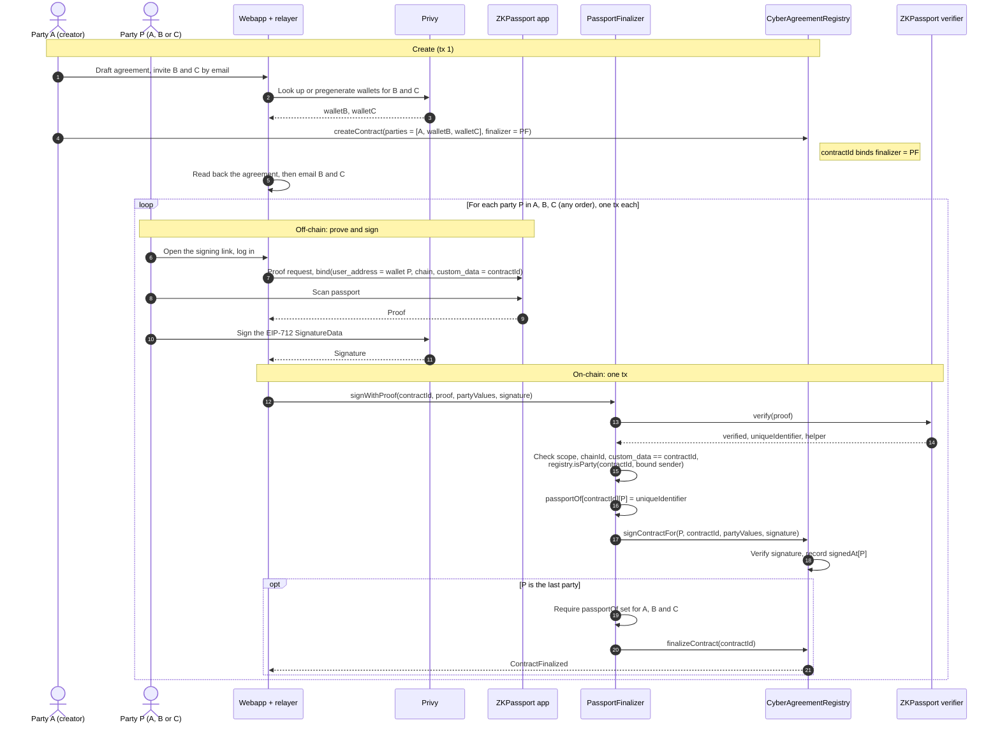

# CyberAgreement — ZKPassport Gate (Three-Party Workflow)

A new `PassportFinalizer` contract is the agreement's `finalizer`. The registry does not change.
Each party sends one transaction. It records the party's ZKPassport proof and the party's
signature together. The agreement finalizes only when all parties have a proof record and a
signature.

- `signWithProof(contractId, proof, partyValues, signature)`:
  1. Verifies the proof and stores `passportOf[contractId][party] = uniqueIdentifier`. The party is
     the proof's bound sender.
  2. Forwards the signature to `registry.signContractFor(party, ...)`. The registry accepts a
     relayed signature only from the finalizer, because the finalizer is set.
  3. If all parties have signed and have a proof record, calls `registry.finalizeContract`.
- `attest(contractId, proof)` does steps 1 and 3 only. It is a backup for a party that signed
  directly on the registry. The normal flow does not use it.

The example has three parties. A is the creator. B and C are email parties with pregenerated
Privy wallets. The webapp creates the agreement in its own transaction, because it reads the
agreement back before it offers any signature.

## Workflow

Total: four transactions. One creates the agreement. Each party sends one.

## Notes

- **Order.** The parties can act in any order and at different times. The last
  `signWithProof` finalizes the agreement.
- **Relaying.** `signWithProof` takes the party from the proof's bound sender, not from
  `msg.sender`. Anyone can submit it. The registry still checks the party's own signature.
  `custom_data = contractId` ties the proof to this agreement.
- **Self-submission.** A party can call `registry.signContractFor` from its own wallet and skip
  the proof. That party then has no proof record, so the agreement does not finalize. The party
  sends `attest` to record the proof. If that is the last missing proof, `attest` finalizes the
  agreement. The webapp must treat `finalized` as the effective state.
- TODO: Decide the proof scope. One app-wide scope makes `uniqueIdentifier` the same in every
  agreement, so it links all agreements of one passport on-chain. A per-agreement scope
  (`scope = contractId`) prevents that link.
- TODO: Decide if every party needs a proof, or only some parties.
- TODO: Support the standalone path (`createStandaloneContractAndSign`,
  `createStandaloneContractAndSignFor`). It fixes `finalizer = address(0)`, so the gate does not
  apply. The webapp email flow does not use it now.
