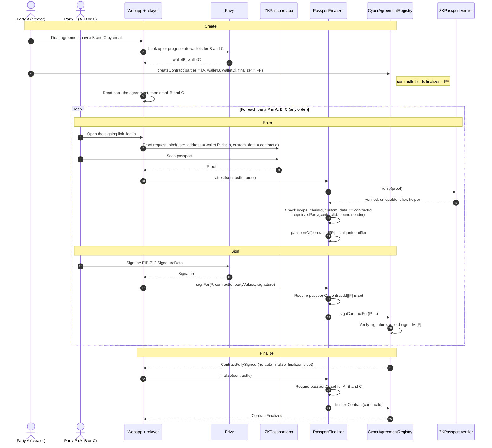

# CyberAgreement — ZKPassport Gate (Three-Party Workflow)

A new `PassportFinalizer` contract is the agreement's `finalizer`. The registry does not change.
Each party records a ZKPassport proof for the agreement. The agreement finalizes only when all
parties have a proof record and a signature.

- `attest(contractId, proof)` stores `passportOf[contractId][party] = uniqueIdentifier`.
- `signFor(...)` forwards a signature to `registry.signContractFor`. The registry accepts a relayed
  signature only from the finalizer, because the finalizer is set.
- `finalize(contractId)` checks a record for every party, then calls `registry.finalizeContract`.

The example has three parties. A is the creator. B and C are email parties with pregenerated
Privy wallets.

## Workflow

## Notes

- **Order.** Each party proves before it signs through `signFor`. The parties can act in any
  order and at different times.
- **Relaying.** `attest` takes the party from the proof's bound sender, not from `msg.sender`.
  Anyone can submit it. `custom_data = contractId` ties the proof to this agreement.
- **Self-submission.** A party can call `registry.signContractFor` from its own wallet and skip
  `signFor`. The agreement then becomes fully signed but not finalized. `finalize` still requires
  all three proof records. The webapp must treat `finalized` as the effective state.
- **Finalize caller.** `finalize` has no access control. It can only finalize an agreement that has
  all signatures and all proof records.
- TODO: Decide the proof scope. One app-wide scope makes `uniqueIdentifier` the same in every
  agreement, so it links all agreements of one passport on-chain. A per-agreement scope
  (`scope = contractId`) prevents that link.
- TODO: Decide if every party needs a proof, or only some parties.
