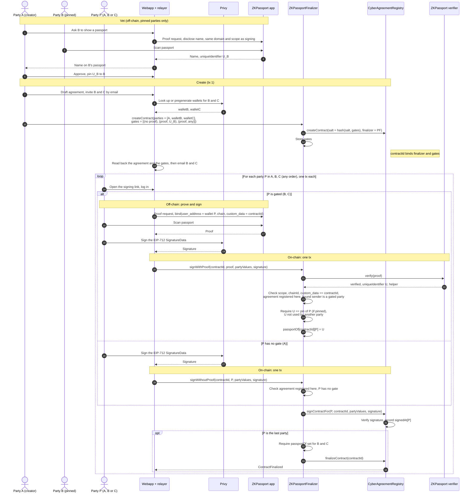

# CyberAgreement — ZKPassport Gate (Three-Party Workflow)

A new `ZKPassportFinalizer` contract is the agreement's `finalizer`. The registry does not change.
The creator sets a gate for each party: proof required or not. Each party sends one transaction.
For a gated party, that transaction records the party's ZKPassport proof and the party's signature
together. A party with no gate only signs. The agreement finalizes only when all parties have
signed and each gated party has a proof record.

The creator can also pin a passport to a gated party. The creator first checks that party's
passport off-chain (for example, the name on it). The pin is that passport's `uniqueIdentifier`.
The party can then sign only with that passport.

- `createContract(templateId, salt, globalValues, parties, partyValues, expiry, gates)`:
    1. Requires one gate for each party. A gate is `(proofRequired, passportId)`. `passportId =
       bytes32(0)` means "any passport". A pin requires `proofRequired`. Two parties cannot have
       the same pin. Refuses an open slot (zero-address party), because gates and passport records
       belong to a party address. Refuses a repeated party address, because the registry records
       one signature for each address and such an agreement cannot finalize.
    2. Calls `registry.createContract` with `finalizer = ZKPassportFinalizer`, `secretHash = 0` and
       `salt = keccak256(abi.encode(salt, gates))`. Thus `contractId` binds the gates.
    3. Stores the gates and marks the agreement as registered here. A pinned passport is reserved
       for its party from the start.
- `signWithProof(contractId, proof, partyValues, signature)`, for a gated party:
    1. Verifies the proof. The party is the proof's bound sender. Requires that the agreement is
       registered here and that the party is gated.
    2. If the party has a pin, requires `uniqueIdentifier == pin`.
    3. Requires that no other party of this agreement used the same `uniqueIdentifier`.
    4. Stores `passportOf[contractId][party] = uniqueIdentifier`.
    5. Forwards the signature to `registry.signContractFor(party, ...)`. The registry accepts a
       relayed signature only from the finalizer, because the finalizer is set.
    6. If the agreement is ready, calls `registry.finalizeContract`. Ready means all parties have
       signed and each gated party has a proof record.
- `signWithoutProof(contractId, party, partyValues, signature)`, for a party with no gate: requires
  that the agreement is registered here and that the party is not gated. Then it does steps 5–6.
- `attest(contractId, proof)` does steps 1–4 and 6 only. It is a backup for a gated party that
  signed directly on the registry. The normal flow does not use it.
- `finalize(contractId)` does step 6, and reverts if the agreement is not ready. It is a backup for
  an agreement whose last party signed directly on the registry. The normal flow does not use it.
- `createStandaloneContractAndSignWithProof(title, legalContractUri, globalFields, partyFields, salt,
  globalValues, parties, partyValues, expiry, gates, proof, signature)` and
  `createStandaloneContractAndSignWithoutProof(..., gates, signature)` are the gated forms of the
  registry's `createStandaloneContractAndSign` and `createStandaloneContractAndSignFor`:
    1. Create the template if it does not exist. The template id is the same as on the registry's
       standalone path.
    2. Do the steps of `createContract`.
    3. Sign for the first party with `partyValues[0]`: the first form as `signWithProof` (the
       proof's bound sender must be the first party), the second form as `signWithoutProof`. A
       single-party agreement finalizes in this one transaction.

  Both forms take the signer from the proof or from `parties[0]`, so anyone can relay them. Thus
  two functions cover both registry functions. The registry functions do not change. They still
  fix `finalizer = address(0)`, so they make ungated agreements only.

The example has three parties. A is the creator and needs no proof. B and C are email parties with
pregenerated Privy wallets. Both need a proof. A pins B's passport and leaves C unpinned. The
webapp creates the agreement in its own transaction, because it reads the agreement back before it
offers any signature.

## Workflow

Total: four transactions. One creates the agreement. Each party sends one. The vetting step is
off-chain.

## Notes

- **Order.** The parties can act in any order and at different times. The last
  `signWithProof` or `signWithoutProof` finalizes the agreement.
- **Relaying.** `signWithProof` takes the party from the proof's bound sender, not from
  `msg.sender`. `signWithoutProof` takes the party as an argument. Anyone can submit either call.
  The registry still checks the party's own signature. `custom_data = contractId` ties the proof
  to this agreement.
- **Gates.** A gated party cannot sign through `signWithoutProof`. A party with no gate cannot
  record a proof, so it cannot take a passport from a gated party.
- **One passport, one party.** Within one agreement, each `uniqueIdentifier` can fill one party
  only. A pin stops a party from using another person's passport. An unpinned gated party can use any
  passport that no other party of the agreement used.
- **Pins and scope.** `uniqueIdentifier` depends on the passport, the domain and the scope. The
  vetting proof and the signing proof must use the same domain and scope, or the pin never
  matches. The scope cannot be `contractId`, because `contractId` depends on the gates.
- **Pinned party visits twice.** A pinned party opens the app once for vetting and once to sign.
  Other parties open it once.
- **Create front-run.** Anyone can call `registry.createContract` with the same arguments and the
  derived salt before the creator. The registry then refuses the creator's call, and
  `ZKPassportFinalizer` has no record of that agreement, so it refuses every signature. The attacker
  gains nothing. The creator must create again with a new salt.
- **Self-submission.** A party can call `registry.signContract` from its own wallet. The registry
  then does not finalize, because the finalizer is set. A gated party has no proof record after
  this, so it sends `attest` to record the proof. If the last signer has no gate, anyone sends
  `finalize`. Both finalize the agreement when it is ready. The webapp must treat `finalized` as
  the effective state.
- **What the record proves.** The holder of passport `uniqueIdentifier` approved this agreement
  for this wallet on this chain. The contract reads no other passport fact: no name, nationality,
  age or sanctions status. For a pinned party, the creator checks these facts off-chain during
  vetting (for example, a name disclosure, a nationality-exclusion proof or a sanctions proof).
  The contract relies on that vetting and records only that the signer used the vetted passport.
  A gated party with no pin gets no such check. A party with no gate gives no passport.
- **Proof age.** The ZKPassport verifier checks the proof date:
  `proofDate <= block.timestamp < proofDate + validityPeriodInSeconds`. The submitter sets
  `validityPeriodInSeconds`, and the proof does not bind it, so the check gives no real age limit.
  `ZKPassportFinalizer` adds no cap. The proof must name `contractId`, so the holder makes it for
  this agreement only.
- **Proof format.** The proof binds `custom_data` to `contractId` as a lowercase `0x` hex string
  of 32 bytes.
- **Dev mode.** The verifier accepts a mock-passport proof only in dev mode. `ZKPassportFinalizer`
  takes a `devMode` flag at `initialize`. Without it, the contract refuses a proof with
  `devMode = true`. The deploy script sets the flag on a testnet only, so tests can use mock
  passports there. On mainnet, the registry has no mock certificates, so the verifier refuses a
  mock-passport proof anyway.
- TODO: Decide the proof scope. It must be the same for vetting and signing. One app-wide scope
  makes `uniqueIdentifier` the same in every agreement, so it links all agreements of one passport
  on-chain.
- TODO: Decide if one person can fill two parties (for example, as an individual and as an officer
  of a company). The one-passport-one-party rule refuses this now.

## Invariants

1. An agreement with `finalizer = ZKPassportFinalizer` finalizes only when every party has signed
   and each gated party has a passport record.
2. A passport record comes only from a proof that verifies, has the expected domain and scope,
   is bound to this chain and to this `contractId`, and is not in dev mode unless the deployment
   allows dev mode.
3. The record goes to the proof's bound sender. That address must be a gated party of the
   agreement.
4. A pinned party's record equals its pin. Only a gated party can have a pin.
5. Within one agreement, a passport fills one party only, and each party has one record.
6. Only `ZKPassportFinalizer.createContract` and the two standalone functions register an
   agreement and its gates. `contractId` binds the gates through the salt.

## Acceptance tests

| Case                                                                              | Expected                                         |
|-----------------------------------------------------------------------------------|--------------------------------------------------|
| Three parties, each `signWithProof`, any order                                    | Last call finalizes; each record stored          |
| Pinned party proves with its pinned passport                                      | Signs                                            |
| Pinned party proves with another passport                                         | `PassportPinMismatch`                            |
| Two parties prove with the same passport                                          | Second call `PassportAlreadyUsed`                |
| Unpinned party proves with another party's pinned passport                        | `PassportAlreadyUsed`                            |
| Two parties with the same non-zero pin at create                                  | `DuplicatePin`                                   |
| `gates` length differs from `parties`                                             | `GatesLengthMismatch`                            |
| Pin on a party with no gate                                                       | `PinWithoutProofRequired`                        |
| Zero-address party at create                                                      | `OpenSlotNotSupported`                           |
| Same party address twice at create                                                | `DuplicateParty`                                 |
| Different pins, same other arguments                                              | Different `contractId`                           |
| Different `proofRequired`, same other arguments                                   | Different `contractId`                           |
| Gated and ungated parties, any order                                              | Last call finalizes; ungated party has no record |
| No party gated, each `signWithoutProof`                                           | Last call finalizes                              |
| Gated party calls `signWithoutProof`                                              | `ProofRequired`                                  |
| Ungated party calls `signWithProof`                                               | `ProofNotRequired`                               |
| Ungated party signs last on the registry directly, then `finalize`                | Finalizes                                        |
| `finalize` before all sign, or a gated party has no record                        | `NotReadyToFinalize`                             |
| Agreement created on the registry directly                                        | `signWithProof` and `signWithoutProof` revert `AgreementNotRegistered` |
| Proof fails, zero helper, wrong scope, wrong chain, wrong `custom_data`, dev mode | Reverts with the matching error                  |
| Dev-mode proof on a dev-mode deployment                                           | Signs                                            |
| Bound sender is not a party                                                       | `NotAParty`                                      |
| Valid proof, bad signature                                                        | Registry reverts; no record stays                |
| Party signs on the registry directly, then `attest`                               | Last `attest` finalizes                          |
| `attest` before the party signs                                                   | `NotSigned`                                      |
| Same party proves twice                                                           | `AlreadyRecorded`                                |
| Non-last party signs                                                              | Not finalized                                    |
| Standalone: new template, three parties                                           | Creates template and agreement; first party signs |
| Standalone: template exists                                                       | Uses it                                          |
| Standalone: single party                                                          | Finalizes in one transaction                     |
| Standalone: bound sender is not the first party, same or other party values       | `SignerNotFirstParty`; no agreement stays        |
| Standalone: pin mismatch                                                          | `PassportPinMismatch`; no agreement stays        |
| Standalone without proof: ungated first party                                     | Creates agreement; first party signs             |
| Standalone without proof: gated first party                                       | `ProofRequired`                                  |
